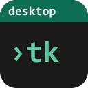
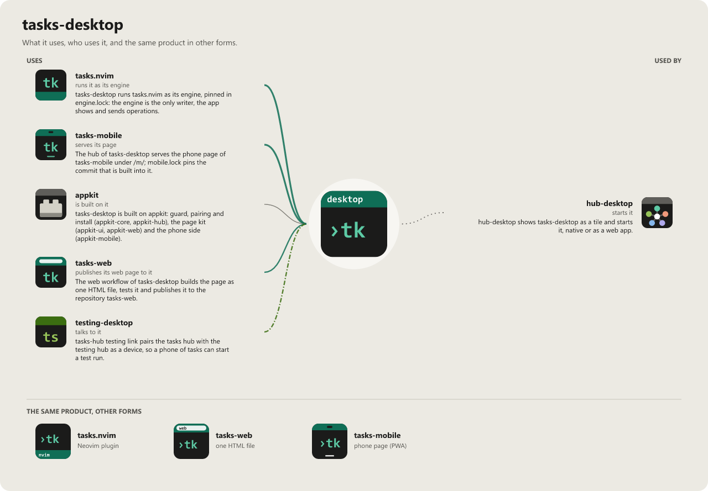

# tasks-desktop

[](https://wkdsteve.github.io/wkd/apps/tasks-desktop/)

A local web UI and desktop app for [tasks.nvim](https://github.com/WKDSteve/tasks.nvim):
see the vault at a glance, create and move tasks, plans and a dashboard,
in the browser first and later as a small native app.

**Status: in use, no versioned release yet.** The hub reads and writes the
vault through the engine (create, set fields, finish, move), searches the text
of the tasks, tells open pages when the vault changed, runs in the background
with an optional login entry and serves the interface to the browser and to a
phone (`/m/`). The same interface runs without any install as one HTML file
([tasks-web](https://github.com/WKDSteve/tasks-web)). There is no window of its
own: the app is the hub program and your browser. The newest green `main` is the
[rolling build](#the-rolling-build-the-newest-main-one-click) (pre-release
`latest`); a release `vX.Y.Z` has not been published.

> **Run `install`, `start` and `autostart` in a normal terminal.** A packaged
> app (the Claude desktop app is an MSIX) and its child processes get what
> they write below `AppData`, and into the registry, redirected into the app's
> private store: the program, the settings and the login entry would exist for
> that app and be missing for you. The commands say so when they notice it.

## Principles

- **The engine is the only writer.** The hub never parses or formats
  frontmatter; it talks to tasks.nvim through the versioned documents
  `tasks-export/1` (read) and `tasks-ops/1` (write).
- **Loopback only, token always.** Host and Origin are checked, there is no
  data endpoint without a session. See [docs/SECURITY.md](docs/SECURITY.md).
- **No console window, nothing left behind.** Every program the hub starts is a child bound to it, a program of
  somebody else started visibly, or a link the system opens; the list is in [docs/PROCESSES.md](docs/PROCESSES.md).
- **Data classes fail closed.** An area without an entry in the per-device
  `areas.json` is treated as not released.
- tasks.nvim stays a pure Lua plugin. This repository holds the hub, the UI
  and the native shell.

## Use

`install` (every way: the install line, `scripts\build-install.ps1`, a double click that installs) makes the program a
command named after the app, `tasks-desktop`, in every new terminal (PowerShell, cmd, Git Bash): a starter in
`%LOCALAPPDATA%\appkit-family\bin`, which goes on the PATH of your user once; `uninstall` takes it away. It is the same
program as `tasks-hub` below, so every command works under both names.

```
tasks-desktop                 start the hub when it does not run, and open the page
tasks-desktop open            the same: open the page, starting the hub first when needed
tasks-desktop start [--open]  run the hub in the background
tasks-desktop stop | quit     end it
tasks-desktop restart         stop, then start
tasks-desktop status [--json] does it run (process, port, version)? exit code 0 yes, 1 no
tasks-desktop link            print a one-time pairing link (for a phone, a tunnel or a script)
tasks-desktop logs [-f]       the end of the log of the hub in the background
tasks-desktop paths           where the program, the settings and the log are
tasks-desktop help [<cmd>]    all commands, or one
tasks-desktop completions <shell>  tab completion script for powershell or bash
```

Tab completion: put `tasks-desktop completions powershell | Out-String | Invoke-Expression` in your PowerShell profile (`$PROFILE`),
or `source <(tasks-desktop completions bash)` in `~/.bashrc`.

These are the commands of every hub app of the family (`hub-desktop`, `rules-desktop`, `testing-desktop`). Exit codes:
0 done, 1 failed, 2 wrong arguments. `open` printed the pairing link in earlier versions; that is `link` now, and
`open --launch` still works and does what `open` does. The commands of tasks-desktop itself:

```
tasks-hub serve [--port 1024-65535]   run the hub until Ctrl-C
tasks-hub start [--open]               run the hub in the background (no window; log: hub.log
                                      in the config folder); --open also opens the browser.
                                      It ends itself 10 minutes after the last page closed
                                      (see "A hub in the background ends itself")
tasks-hub stop                        stop the hub that runs in the background
tasks-hub autostart on|off|status     start the hub with your login, also in the Options menu of the page and the tile
                                      of hub-desktop; all three show the same: while hub-desktop starts with your
                                      login it starts the hub (start_with_hub), otherwise the hub's own entry
                                      (Windows: Run key; Linux: autostart entry; macOS: launch agent)
tasks-hub install [--autostart] [--shortcut]
                                      copy the program to a fixed place (Windows:
                                      %LOCALAPPDATA%\tasks-desktop\bin; elsewhere:
                                      tasks-desktop/bin in $XDG_DATA_HOME or ~/.local/share),
                                      so a build in the repository does not fight the running hub
                                      for the file; --autostart and --shortcut register that copy
                                      (Windows: registry and desktop link; Linux: an autostart
                                      entry and a launcher; macOS: a launch agent). Build with
                                      `cargo build --release` first (about 3.9 MB: full LTO,
                                      stripped).
tasks-hub uninstall [--purge-settings] stop the hub, take away the login entry and the link;
                                      --purge-settings also removes the settings (never the
                                      vault); the program file is left for scripts/uninstall.*
                                      (it acts on the installation of this user, whichever copy
                                      of the program you run it from: a build in target/ included)
tasks-hub open --phone [--no-window]  a pairing link for a phone through Tailscale Serve, as a QR code
tasks-hub usage [--days=14]           on how many of the last days the interface was opened
```

## In the browser, without installing

For a machine where no program may be installed: the page runs alone in Chrome or Edge (in Firefox and Safari read only) from one HTML file,
`tasks.html`, with the tasks.nvim engine inside it. There is no hub, no server and no network request (the page's CSP forbids
one).

1. Get the file: `git clone` (later `git pull`) of the public repository
   [tasks-web](https://github.com/WKDSteve/tasks-web); compare `Get-FileHash tasks.html` with `SHA256SUMS`. The start
   script below, run by hand, pulls and checks the sums before it opens the page (`start-tasks.cmd /update` does only
   that; the shortcut it makes starts the browser alone and updates nothing), and Options >
   "Update the page ..." in the page names its build (ref, commit, day) and gives the lines to copy; the page itself
   fetches nothing.
2. Open `file:///<path>/tasks-web/tasks.html` in Chrome, or run `start-tasks.cmd` there (it finds Chrome, `/app` for a
   window of its own, `/shortcut` for a shortcut on the desktop and in the Start menu). Without the script: Options >
   "Create a shortcut ..." in the page gives the line for Windows' "New > Shortcut" (Chrome as a window of its own, or
   the plain address); Chrome saves no downloaded `.lnk` or `.url`, so the page offers none.
3. Press "Choose folder ..." and pick the vault folder. The page reads the `*.md` files, `areas.json`,
   `area-groups.json` and `tasks-vault.json` into memory (`.git` and hidden folders are skipped); of the files below an
   `assets/` folder (the attachments of a task, a meeting, an entry of a list) it notes only the name, size and time,
   never the content, except the boards of the drawing surface. A folder with no area
   (the folder above the vault, or one area) is refused with a notice that names a folder inside it that looks like the
   vault, instead of an empty vault. After a restart of Chrome, press "Allow
   access" once for the folder used last. Project > "Open another vault ..." goes back to this first screen, where
   another folder is chosen or one is forgotten (taken off the list).
4. Switching vaults: the menu Project lists the vault folders used before (five at most, by folder name), the one read
   now marked, at the same place and with the same words as the Vaults part of the app. One click reads another: the
   page loads again with that folder, in the filter, order and view it was left with (those are kept per vault; the
   language, the theme and the columns are the same in every vault; what the page kept before the update goes to the
   first vault opened after it). After a restart of Chrome the click on a vault
   asks Chrome once for access to its folder. The page still reads one folder at a time.
5. Changes made on disk (Neovim, git, agents) show up when the tab gets focus, or within 30 seconds. Writing from the
   page (create, set a field, done, move) compares each file with what was read and writes nothing on a conflict.
   Attachments work as in the app: a file, a picture (also pasted with Ctrl+V in the tab Lists), a board, a recording;
   finishing or moving a folder task, or making an entry of a list a task, moves its attachments in the folder (the
   browser's own move, so the bytes are never copied through the page).

Which browser does what (the page checks the browser itself and says so on the first screen):

| Browser | Folder | Reading | Writing | Remembers the folder | Sees changes on disk |
| --- | --- | --- | --- | --- | --- |
| Chrome, Edge (Baseline widely available) | picker (`showDirectoryPicker`) | yes | yes | yes, "Allow access" after a restart | yes, on focus and every 30 s |
| Firefox, Safari (Baseline widely available) | folder input (`webkitdirectory`) | yes | **no**: the page is a view, a banner says so, a change is refused with the reason | no, choose the folder at every start | no, choose the folder again |
| any other | none | no, the page names Chrome and Edge | no | no | no |

The oldest browser is the one of Baseline "widely available" (`.mwgrc`, `browserslist` in `ui/package.json`; today Chrome and
Edge 125, Firefox 126, Safari 17.5, and the line moves up with the Baseline), no longer a version named here. That
Firefox and Safari only read has nothing to do with their version: they have no API for a folder to write to
(`showDirectoryPicker`), and that does not change with a newer one.

The table is what CI finds: `ui/e2e-web/engines.spec.ts` asks the page in each engine for the APIs it needs and the
read only way in (`ui/e2e-web/readonly.spec.ts`) runs in Playwright's Firefox and WebKit as they are. Last record
(2026-10-30, Playwright 1.63): Chrome has the picker; Firefox 155 and WebKit 26.6 have no picker but the folder input,
`DecompressionStream`, `Uint8Array.fromBase64`, IndexedDB and a blob worker with WebAssembly; the Origin Private File
System opens in Firefox and fails in WebKit from `file://` (`UnknownError`), which the page does not need. WebKit on
Windows stands in for Safari; a real Safari on macOS is not tried.

What is missing compared to the app: tray, autostart, notifications, "show in Explorer", "open in editor",
the picture on the clipboard of the hub's machine (paste it instead), several vaults at once. Details of
writing, data classes and limits: the web variant section under "Layout" and `docs/SECURITY.md`.

## Install from a release

There are two channels, and both carry an install script that installs exactly their build:

- **A release** (a tag `vX.Y.Z`, published by hand after a draft was tried) holds the program for
  Windows. CI and the builds run on the maintainer's self-hosted Windows runner (see
  [docs/RELEASING.md](docs/RELEASING.md)); there is no Linux or macOS archive and no `install.sh` any more. The code still has the Linux and macOS paths (autostart entry, launch agent) and
  builds there from source, but nothing builds or tests them in CI.
- **The rolling build** (the pre-release `latest`) is the newest green commit of `main`, rebuilt
  after every CI run: for trying what is new, not for anything that matters.

The scripts need no administrator rights and install for one user, so they also work where a signed
Setup is not allowed or SmartScreen stops a downloaded program. Run them in your own terminal (not
elevated, not from inside a program that sandboxes AppData). The repository is public: the download
needs no GitHub login and no token:

```
# the rolling build (Windows)
irm https://github.com/WKDSteve/tasks-desktop/releases/download/latest/install.ps1 | iex

# a release: the same with the tag in place of latest, e.g. .../releases/download/v0.1.0/install.ps1
```

Type the line into the PowerShell session as it is. Wrapped in a new `powershell -ExecutionPolicy Bypass -c "..."`, Microsoft Defender reports the command line as a trojan (`Trojan:Win32/Commando.B!ml`) and nothing is installed.

They download the program of that build, check it against its `SHA256SUMS` (a wrong or missing
checksum installs nothing), and hand over to `tasks-hub install`, which replaces the program in one
step and brings a running hub back. It ends with the whole call that starts it (`start it: "...\bin\tasks-hub.exe"
start --open`) and says whether that folder is on `PATH` (install does not add it there; the Start menu entry starts it too). The installation that is there is found and replaced, never a
second one beside it: the script of `latest` run again updates to the newest rolling build, the
script of a release run again repairs that release (to update, take the script of the newer
release, or pass `-Version`/`-Rolling`). A pipe into `iex` takes no arguments; to pass them, run the
downloaded text as a script block in a PowerShell session:
`& ([scriptblock]::Create((irm https://github.com/WKDSteve/tasks-desktop/releases/download/latest/install.ps1))) -InstallArgs '--shortcut'`
adds a link (the Options menu of the page registers the hub with your login, if you want that). The other options are `-Version vX.Y.Z` / `-Rolling` for
another channel and `-File FILE` for a file you already have, with `-Sums FILE` or `-Sha256 HEX`. Through
`powershell -File` an array arrives as one string, so a saved `install.ps1` takes one `-InstallArgs`
value there; in a PowerShell session a list is fine. The install scripts are the ones of appkit's
[release-kit](https://github.com/WKDSteve/appkit/tree/main/release-kit), stamped for this app and
the channel when they are attached; `scripts/test-install.*` try the script of the pinned kit
against the hub in the CI of every commit and in the build of every release.

**Or build this checkout and install it** (Windows; Rust, Node and the toolchain of [Build](#build)):
the same steps as the rolling build, then `tasks-hub install` of the program built here. Nothing is downloaded but the packages
of the lock files, and a file built on the machine carries no mark for SmartScreen to stop.

```
.\scripts\build-install.ps1 [-BuildOnly] [-InstallArgs '--shortcut']
```

```
.\scripts\uninstall.ps1 [-PurgeSettings]
sh scripts/uninstall.sh [--purge-settings]        # Linux/macOS, from source; not run by CI any more
```

Uninstalling stops the hub, takes away the login entry and the link, and removes the program. Your
settings stay unless you ask; your vault and your tasks are never touched. If a step fails the
program stays, so that nothing points at a missing file. How a release is made:
[docs/RELEASING.md](docs/RELEASING.md).

The hub keeps one Neovim process as its engine and asks it over a line
protocol (about a fifth of the time of one process per question, measured on
the real vault: a task detail 225 ms instead of 825 ms). If that process is
not there the hub falls back to one process per question by itself;
`TASKS_HUB_ENGINE=process` forces that way.

The hub tries port 17615 first (the port is part of the origin, so it is
fixed). If it is taken the hub starts on a free port and says so; the page
then has another origin.

`tasks-hub link` prints `http://127.0.0.1:PORT/#pair=<code>`. The code is
good once and for 60 seconds.

```
tasks-hub areas propose [--private=a,b] [--write]   a data class for every area (a proposal)
tasks-hub areas check                               fails while an area has no data class
```

Which areas may leave the hub is decided per device in `areas.json` in the
config folder; an area with no entry counts as unclassified and is released
for nothing. `propose --write` writes `areas.proposed.json` next to it; the
hub reads only `areas.json`.

To not decide area by area, `areas.json` may carry `"default": "internal"`
(or `public`, `private`): the class of every area the file does not name.
An entry still wins, so `"secret": {"class": "private"}` stays private. Without
`default` an area with no entry is unclassified. That file (schema 1) is the classes of the vault `main`. When you
read more than one vault, use schema 2, whose keys are `<vault>:<area>` (`"work:lib.nvim": {"class": "private"}`, and
`"vaults": {"work": {"default": "internal"}}`): two vaults may have an area of the same name, and each keeps its own
class; a vault the file does not name has everything unclassified. `tasks-hub areas propose` writes schema 2 as soon as
the vault is not `main` or the file is already schema 2, and keeps what the other vaults decided. See
[docs/SECURITY.md](docs/SECURITY.md).

## From another device, over an SSH tunnel

The hub binds loopback only and takes no other `Host`, so nothing about it opens to the network. To use it from another
device, tunnel to it with the **same port on both ends**: the `Host` and the `Origin` have to name that port.

```
ssh user@machine tasks-hub link
ssh -N -L PORT:127.0.0.1:PORT user@machine
```

The first command prints a pairing link for the running hub, with its `PORT`; with the tunnel up, open that link on the
device. The code in the link is for one use, like on the machine itself, and the session is that browser's. A tunnel adds
no rights of its own: whoever can use this local port on the device can reach the pairing page, so do not forward it with
`-g`. A port the device already uses cannot be forwarded: then free it, or set another `port` in the hub's settings.

### The phone page (`/m/`)

On a phone, open the same link with `/m/` in front of the `#` (`http://127.0.0.1:PORT/m/#pair=<code>`): that is
[tasks-mobile](https://github.com/WKDSteve/tasks-mobile), a page made for a phone that can be installed as an app
(Chrome on Android: menu, *Install app*) and that is a share target for links and text from other apps. It lists the
open tasks (starting on *Today*: what the engine would take next, open questions, what is due, the counts), creates
one (with a photo or a voice note if wanted, which become assets of the task once the engine made it), sets a status,
answers open questions and finishes a task after the engine said what that sets off; offline it keeps the last list
(14 days at most) and queues what you create or change until the hub is reached again. It shows and keeps only areas of the class `public` or `internal`. The page is built from the commit
`mobile.lock` pins (`python tools/build-mobile.py`) and embedded in the program; its policy is the desktop page's plus
its manifest, its service worker and the one Trusted Types policy it registers the worker with, and for the voice
note the microphone (`microphone=(self)`, `media-src 'self' blob:`), on `/m/` only; the desktop page keeps the
microphone off (see appkit's SECURITY.md). How to use it on a phone: [docs/USAGE.md of tasks-mobile](https://github.com/WKDSteve/tasks-mobile/blob/main/docs/USAGE.md).
A phone pairs **once**: it keeps a key of its own (made by the page, which cannot be read out of the phone) and signs
in by itself on every start, also after the PC or the hub restarted. The hub keeps the paired phones in `devices.json`
in its settings folder; on the PC:

```
tasks-hub devices                          the paired phones: id, name, level, when paired, when last used
tasks-hub devices revoke <id>              revoke one: its sessions end, it has to pair again
tasks-hub devices level <id> read|create|change|trigger
                                           what one may do; its open sessions follow at once
```

A lost phone: revoke it here (and, with a tunnel over Tailscale, remove it from the tailnet).

A paired phone reaches only what the phone page asks (fail closed, appkit's `MOB-02`): the list (`snapshot`,
`areas`, `next`), a task (`task`), what finishing it sets off (`done_preview`), the writes (`ops`), its photos and
voice notes (`upload`), its own level (`device`: what it may do now, so the page offers only that) and the learning
paths (`paths`, `path`, cut to what is a path's own; a point is ticked with `node_set`), the next learning steps and
the series of the learning figures for its page Lernen (`learn_next`, `learn_history`, asked of the engine for the
released areas alone and cut) and the meetings (`meetings`,
`meeting`, cut by the class of their area; a line of the minutes is written with `meeting_capture`). Everything else, the choice of vault among it, answers a phone `403 not_for_devices`.

The hub also cuts what these routes tell a phone (`MOB-02`, the hub cuts, never the phone): only the areas of the
class `public` or `internal` in `areas.json`. A private area, or one without a class, is not there for a phone at
all: not in the list, the areas or the proposals, not even as a name or in the counts; a task of it, its preview of
finishing and every write or upload to it answer `404 not_found`, as a task that does not exist (a new task into such
an area too). A task is given field by field from a fixed list (no file path, no reference to another task outside the
released areas, no problem text); a plan or project only when its own area and every area it holds are released, its
target and project only when the phone may know them. What a write or an upload answers is cut the same way: the
outcome, the ids of released areas, the plans and projects it closed that the phone may know, an error by its code
(not its text, no notes, no files). No document tells the `rev` or `digest` of the whole vault (they move with a
change in a private area too); the snapshot has a `rev` of its own, over what the phone is given. The proposals of
`next` are those of released areas: when the engine's pick over the vault is elsewhere, the hub asks per released area.
The PC gets everything as before. Its level decides what it may write (`MOB-03`):

| Level | The phone may |
|---|---|
| `read` | read the list and the tasks |
| `create` | also create a task and answer an open question |
| `change` | also add a photo or a voice note to a task (`upload`), set a status and finish a task; **a newly paired phone starts here** |
| `trigger` | also ask this hub to run the test sheets of a task on the PC (`testing_start`, see "The test sheets of a task, from the phone" below), each time with the phone's confirmation of that very request; only the PC raises a phone to it |

Of the operations of `ops` a phone sends only `new`, `answer` (create), `set` and `done` (change), and of each only the
fields the phone page sends: `new` an area, a title and a text; `set` only the status (with `if_match`); `answer` the
question and the option; `done` its confirmation. Any other operation (moving, ordering, plans, views, an image from
the clipboard of the PC, ...) and any other field (a title, a plan or a reminder through `set`, `force` that breaks a
claim, `by` that acts for someone else, ...) answers it `403 not_for_devices`, at any level.
Below `trigger`, nothing a phone may do starts something on the PC.

**Through Tailscale**, without a tunnel: `tailscale serve --bg 17615` forwards `https://<pc>.<tailnet>.ts.net` to the
hub (which still listens on loopback only). Tell the hub that name before it starts, in its environment:
`TASKS_DESKTOP_TAILNET=<pc>.<tailnet>.ts.net` (a plain host name: lower case, no `https://`; `:<port>` only when Serve
forwards another HTTPS port than 443 to this hub, `tailscale serve --bg --https=8443 17615` and
`<pc>.<tailnet>.ts.net:8443`, so that a second hub of the PC keeps 443; another value
stops the start). The hub then also answers that host, but there only to paired phones: pairing a phone with a key
works there, a plain pairing code does not, and neither does anything of the PC. `tasks-hub link` (with the same
variable set) prints the link for the phone too: `https://<pc>.<tailnet>.ts.net/m/#pair=<code>`.
`tasks-hub open --phone` shows that link as a QR code for the phone's camera: in the terminal, black on white
whatever the theme, and in a terminal also as a picture in a window (the one to scan when the terminal's font leaves
gaps between the lines; `--no-window` leaves it out). The command ends when the code is over, after 60 s, and removes
the page of the picture (`pair-qr.html` in the settings folder).

**Notifications (Web Push).** A paired phone may ask to be told (the phone page offers it; the routes `/api/push/*`
are released for phones at `read`, a session of the PC gets `403 device_required` there). The hub sends Web Push
itself, through the push service of the phone's browser (no account anywhere): `decision` when a task starts to wait
for your decision (once per change into the status, also after it left it and came back), and `remind` once a day,
one notice for all reminders (a tap opens *Today*), from 08:00 on when a task has a `remind:` day that has come (that
day or earlier; an open task, or a finished one that keeps a reminder), until its day is moved or taken away. The hour
is a setting of the hub, in `config.json`: `"reminders": { "send_at": "07:30" }` (`HH:MM`, 00:00 to 23:59; another
value stops the start, said plainly); a hub that is off at that hour sends it when it is back the same day. Day and
time are the engine's (`today` and `time` of its `hello`, the clock of this PC); an engine that does not say them
reminds of nothing. A decision carries only its kind and the id of the task, a reminder only its kind; both only for
an area of the class `public` or `internal`: for a private or unclassified area nothing goes out at all, and a day
whose reminders are all of such areas sends none. The phone reads the rest over its paired way. The hub keeps its push key
(`push-key.json`, secret), the subscriptions (`push.json`) and what it told (`notices.json`, per vault, so a restart
or a change of vault tells nothing twice) in its settings folder; revoking a phone forgets its subscription. A notice
no push service took (refused or unanswered for every phone) is told again on the next look. What waits for a
decision while no phone is subscribed is not told later. If `notices.json` cannot be written, the hub says so on its
console and still sends; only after a restart might such a notice come twice. While a phone is subscribed, the hub
looks at the vault every 5 minutes even when no page is open.

**Notices at a time (meetings, reminders at a time of day).** One scheduler sends what is due at a time of its own,
each notice once, by Web Push to a phone that subscribed to its kind and, when the hub has a mail account, by mail to
the addresses the item names:

- `meeting` before a planned meeting (`<area>/MEETINGS/<slug>.md`) begins, at each entry of its `notify`
  (`-15m`, `-2h`, `-1d@18:00`, `-0d@08:00`); a meeting without `notify` gets the default of its vault, `-15m` for a
  meeting with a time, none for an all-day one. A notice the hub missed (the PC was off) is sent late as long as the
  meeting has not begun, else dropped; of several missed ones only the latest goes.
- `meeting_end` once after the end of a meeting that still stands `planned`: "enter the result or finish it?"
  (within 12 hours of the end; none for an all-day meeting).
- `remind` with the id of the task at the time of a task's `remind_at` on its `remind` day (sent late until the end
  of that day). Such a reminder is not a reason for the day's one notice on its own day; from the next day on it is.

A `cancelled` or `done` meeting tells nothing; a moved meeting is told at its new time. Times without `tz` are this
PC's; with `tz` (an IANA zone) they are converted, a time the clock skips or shows twice at a change of summer time is
the one after the gap or the first one. A push carries only the kind and the id; a mail says the title, the time (and
the time as written in another zone), the place, the service, the id to open it by and, after the end, the question.
Fail closed by the class of the area: nothing at all for a private or unclassified area; the address to join only for
a `public` area, for an `internal` one only when the settings release it; participants never. What was sent is kept in
`schedule.json` in the settings folder (per vault, never in the vault). The settings, in `config.json`:

```json
"meetings": {
  "notify": ["-15m"],
  "notify_by_vault": { "main": ["-10m", "-1d@18:00"] },
  "after_end": true,
  "internal_links": false,
  "internal_people": false,
  "lang": "de"
}
```

`notify` is the default of every vault (`[]`: none), `notify_by_vault` that of a vault by its name (read at the start
of the hub), `after_end` switches the question after the end, `internal_links` releases the address to join of
`internal` areas for mails (and for a paired phone), `internal_people` lets the participants of a meeting of an
`internal` area (their names, never an address) reach a paired phone, which may then tick them present (unset: only
those of a `public` area), `lang` (`en` or `de`) is the language of the mails. A value that is not one of these stops
the start, said plainly.

**Meetings through the hub.** The engine's meetings are routes of the hub (a session needed; a paired phone gets
`meetings` and `meeting` cut by the class of the area, writes lines, photos and voice notes into the minutes and ticks
participants where they are released, see `docs/SECURITY.md`):

- `GET /api/tasks/meetings?since=&until=&area=&status=&task=&limit=&offset=`: the meetings whose days touch the window
  (days `YYYY-MM-DD`; without them the engine's default, 30 days back and 90 ahead), one page of at most 100.
- `GET /api/tasks/meeting?id=<area>/<slug>`: one meeting with its body, agenda, participants, documents and follow-ups.
- `GET /api/tasks/meeting/ics?id=<area>/<slug>`: the meeting as an iCalendar file to save (`<slug>.ics`, one event; a
  download, nothing is sent). Its `UID` is `<vault folder>:<id>` and stays the same; its `SEQUENCE` grows by one with
  each change of time, place or status since the last export (kept in `ics-sequence.json` in the settings folder), so
  a calendar takes the new file as the new version of the same event. Times are in UTC, from `tz` or this PC's zone; an
  all-day meeting is a day's event. What it holds follows the class of the area: a private or unclassified area gives
  none (`403 not_released`); an `internal` one title, time, place and service, its address to join only with
  `internal_links`; a `public` one also the address and the participants with an e-mail (the one with the role
  *Organisator* as organizer, *optional* as an optional one).
- `GET /api/tasks/meeting/thumb?id=<area>/<slug>`: the preview of a meeting for calendar and timeline: its `cover`
  (or `image`, the old name) made at most 96 px on its longer edge as PNG, else the picture of a board
  (`assets/boards/`), else a board's drawing as it is (SVG). Only a file below the meeting's own folder is read; the
  small pictures are kept in `cache/thumbs/` of the settings folder, never in the vault. `404 no_image`: none.
- `POST /api/tasks/meeting_parse` with `{ "text": "<one line>" }`: the quick capture. The engine reads the line
  (`24.11. 9:30 90m Workshop @Raum_3.14 https://meet.google.com/abc #lib.nvim/alpha !-15m`) into a proposal of a
  meeting (`tasks.meetingparse`: title, fields, the service of the address, the words it could not read); nothing is
  written. One line of at most 1000 bytes without control characters, in the body so it is in no log of an address.
- `POST /api/tasks/board` with `{ "id", "name", "if_match"?, "ink", "svg" }`: a whiteboard of the page's drawing surface
  saved into `assets/boards/` of a meeting, task, plan or project (`<name>.ink.json` and `<name>.svg`, the engine's
  `board_save`). A board that is there is replaced only on the version read (`if_match`, the `etag` of its last save);
  otherwise the answer is `conflict` with a free name (`<name>-2`). The strokes are read back with
  `GET /api/tasks/asset?file=assets/boards/<name>.ink.json`. Not for a paired phone.

Meetings are made and changed through `ops` (`meeting_new`, `meeting_set`, `meeting_close`, `meeting_capture`,
`meeting_attend`, `meeting_followups`). The page opens the address to join of a meeting only when it is `https://`
(`ui/src/lib/meetingLink.ts`), in a new tab of the system's browser (`rel="noopener noreferrer"`), which hands Teams or
Zoom on; other schemes (`msteams:`, `zoommtg:`) are shown, never opened.

**Contacts through the hub.** A contact is a person of a third party, one file in `<area>/CONTACTS/` (capabilities `contacts`
and `contact` of the engine). `GET /api/tasks/contacts?area=&limit=&offset=` lists them by name (one page of at most 100; the
page reads them all, up to 1000), `GET /api/tasks/contact?id=<area>/<slug>` reads one with its text and its notes; they are
written through `ops` (`contact_new`, `contact_set`, `contact_delete`, each with the engine's inverse for Undo). A session is
needed. A paired phone gets them cut (decided 2026-11-24, `device_cut::contacts`, `device_cut::contact`): only the
contacts of `public` and `internal` areas (a private or unclassified area is not there, fail closed), and the mail
addresses, numbers, text and notes only of a `public` area or of an internal one with the setting `meetings.internal_people`
(the same as the people of a meeting); otherwise the name, organisation, role and tags. A phone makes (`contact_new`, at
`create`) and changes (`contact_set`, at `change`) a contact only there and only with the fields of its form; it never
deletes one (`contact_delete` is for the PC). The engine names no mail address and no phone number in any message; the page does not either: a
status says "saved" and offers Undo, the label of a link names the person, and what a refused change shows next to the
contact (the conflict center) is the data the person typed.

**Learning paths through the hub.** The engine's learning paths (`<area>/ROADMAP/paths/<slug>.md`) are routes of
the hub (a session needed, not for a paired phone yet), asked fresh each time (the state the hub holds answers by is
over the tasks, not the paths):

- `GET /api/tasks/paths?area=&include_done=1`: the open learning paths with their progress (learned, seen, dropped,
  open), no tree; with `include_done=1` (an engine with `requires`) the finished ones too.
- `GET /api/tasks/path?id=<area>/<slug>`: one path with its body and its tree as a flat list in document order.
- `GET /api/tasks/paths?levels=1`: the same with every level of each path (an engine with `paths_levels`).
- The reads of the tab **Lernpläne** over all paths, each needing the engine's capability of the same name:
  `GET /api/tasks/learn_next?area=&path=&machine=&n=` (what to learn next in every running path),
  `GET /api/tasks/learn_notes?q=&kind=note|link|image&area=&path=&include_done=1&limit=` (the notes, links and images of
  the points, the engine searches), `GET /api/tasks/learn_evidence?competence=&area=&path=&include_done=1` (the
  evidence), `GET /api/tasks/learn_history?since=&until=&step=day|week|month&area=&path=` (the series of the learning
  figures) and `GET /api/tasks/competences?area=` (the fields of knowledge and their scale).

A point is ticked, marked seen, dropped or blocked with `node_set`, made a task of its own with `promote` and taken
back with `unpromote` (through `ops`).

The tab **Learning plans** of the menu bar (after View; there only when the engine has the learning paths) holds the
views of the learning plans in sections (Overview, Paths, Progress, Knowledge); a view the engine cannot serve, or one
not built yet, is left out rather than greyed, and a link to one not built yet shows the overview with a word that says
so. While one of its views is shown the tab carries the dot (its name: "Learning plans, current: Overview"); export and
print stay in View. The palette (Ctrl+K) has "Go to ..." for each of them ("Go to Overview of the learning plans").

The view **Learning plans › Overview** (`#view=learn`, the first of the tab) is the glance: the tile **My learning** with
a period (**Today | Week | Month | Quarter | Year**, as the calendar has them, kept on this device) and, from the series
of the learning figures (an engine with `learn_history`), the points learned, the XP (gamification on), the learning
time, the learning days and the streak, each against as many days of the period before in words with ▲/▼ ("+5 vs
last week to Wednesday": Monday to Wednesday against Monday to Wednesday), and the bars of the period (**As table**
shows the same figures as a table). Before the series begins it says from when; without it the tile shows today's state (learned of all points) and why. Beside it the first three next learning
steps (each opens its point in the path), the running paths (the last active first, with progress and level), the next
level of each path within reach (badge, what is missing, its reward) and the number of open rewards. A narrow window
draws the tiles one below the other.

The view **Learning plans › Learning statistics** (`#view=learnstats`) is the history: a period (**Week | Month |
Quarter | Year** as the calendar has them, or **Free …** with two days; kept on this device), **Project** and **Path**
(one path is asked of the engine, its streak is its own). It draws the XP (the points without gamification) per day,
week or month, learned and seen, with their running sum as a dashed line; the learning time per week stacked by path
(the five with the most hours, the rest as "Others", each in its colour and every other one striped, named in the
legend); the learning days as a calendar (weeks by weekdays, five stages, the number in the tooltip) with the current
and the longest streak; and a row per path with what it learned, its XP, hours and the level it reached (and when).
Every chart has **As table**; the menu View › Export saves, copies, prints or pictures the tables (a path of a private area is
not named in them). Before the series begins the bars count only the finished tasks promoted from a point, marked
"incomplete"; without the series (an engine without `learn_history`) the view shows today's state per path.

Four views of the tab gather what all learning paths hold (each only with the engine's capability, the first two only
with gamification on):

- **Badges** (`#view=badges`, capability `paths_levels`): the badge of every level of every path, earned ones in colour,
  open ones grey with a lock and a ring of the way to go; filter (all, earned, open) and grouping (by path, by date).
  The arrow keys move between the tiles, Enter opens the detail below the group (level, date, what is missing), Escape
  closes it.
- **Rewards** (`#view=rewards`, `path_reward`): the rewards of the levels reached and not granted yet, each with
  **Granted** (writes `[x]` into the path, with Undo in the word that follows), the granted ones with their date (and
  **Not granted after all**), and the coming ones with the way to go.
- **Competence catalogue** (`#view=competences`, `competences`): the fields of knowledge of the vault's `competences`
  files, grouped, each with its stage in theory and practice on a ladder of eight rungs, the targets in 12 and 24 months,
  the evidence and the paths that teach it (a click opens the path); filter and sort, the file's text below a row.
- **Evidence** (`#view=evidence`, `learn_evidence`): the evidence points of all paths, given and open, grouped by field
  of knowledge (or by path), with what each proves, a link to the proof and **In the path**, which opens the path on
  that point.

The view **Learning plans › Learning paths** (also in the web variant, `#view=paths`) shows them: the paths with their progress
on the left, the chosen one as a tree on the right, with a bar counted apart (learned, seen, not applicable, open).
A click (or a tap) on the mark of a point ticks it as learned or sets it open again; its menu **More** sets it seen,
not applicable or blocked, each with a reason it asks for first (the key it waits for, for blocked), writes its note
(an engine with `node_note`) and promotes it: the task is made and opened. A parent has no mark of its own, and a
promoted point shows its task with the task's status, or how it ended once it is finished. A link of a point opens in
a new tab without a referrer. The view only shows what the engine counted and sends what was chosen, on the version
it read; when the file changed meanwhile it says so and reads the path again.

With an engine that counts XP (capability `xp`) the view also shows the XP of each point (`25 XP`; a promoted point
the `xp:` of its task), the path's XP as a second bar (`120 / 300 XP`), the level reached with what is missing to the
next (`Level 2 (Profi) · 30 XP to level 3`) and the open rewards of `## Level`, each with **Granted** (`path_reward`:
`[x]` in its line). **XP …** in a point's menu sets its XP (`{xp=N}`), filled in with its own or the engine's
suggestion; empty removes them. A level reached since the path was looked at last is said once, in one line, with its
reward; the first look at a path only notes its level. Everything here is optional and quiet: **Options › Defaults ›
XP, levels and rewards in learning paths** turns it off (kept per browser), the progress stays. The badge of the level
reached stands beside it, and the badges of all levels below the bar (the ones not reached yet grey).
**Set levels and rewards …** (with an engine that writes them, capability `path_levels`) opens a form below the bar:
per level a threshold in XP or percent, a name, a badge (a picture of the path's `assets/badges/`) and a reward, and a
reward for the whole path. The engine writes them into `## Level` as one change (`path_levels`, undone in the toast) and
judges them; a refusal (thresholds that fall, a name too long) is said and the form stays open. **XP of the task …** in
the menu of a promoted point sets the `xp:` of its task (`set`), which the point counts.

The view **Learning plans › Competence map** (`#view=pathmap`, an engine with learning paths) draws the paths as a map: each
path a box with its stage by colour, symbol and word (finished, in progress, waits for …, not started, paused), its
progress and, with XP on, its level; each project a frame around its paths; each `requires` an arrow from the
requirement to what builds on it, hard ones solid with a filled head, soft ones dashed with an open one, open ones in
the warning colour. A path stands one stage to the right of the longest chain before it (a project's requirement
counts for all its paths); a circle of requirements stands last in a red area of its own, a requirement that names
nothing as a red ghost box. A soft requirement not met only puts a "!" on the box; a hard one makes the path wait.
What is met, what waits and the circles are the engine's (capability `requires`; without it the boxes stand without
arrows and a note says why). A click (or Enter) opens the path, a middle click or Ctrl in a new tab, the title of a
frame opens its project. Pointing at a box (or the focus on it) brings its chain forward; Space holds it, `f` shows
only that chain, Esc lets go. The arrow keys walk the chain (Alt: the next one of several), up and down the stage,
`/` finds a path, `+`, `-` and `0` zoom (also Ctrl with the wheel, 50 to 150 %, **Fit** fits the width). **Hide
finished** and **Map | List** are kept per browser; the list says the same as a table per project (stage, progress,
what a path needs and what it is a requirement for) and is the start in a window narrower than about 600 px.

The view **Learning plans › Next learning step** (`#view=learnnext`, an engine with `learn_next`) shows a card for every
running learning path with the next point to learn now and, folded below, the two after it; the engine chooses them
(open, not blocked, not optional, in the order of the file; the paths active last first). A card names the stage, the
source of the point, its planned hours and XP; **Learned** marks it, **Seen…** and **Does not apply…** ask for a reason
first, **Open in the path** shows the point in the view of the paths. On a focused card `l`, `s` and `n` do the same and
Enter opens it. A point under `{safety}` says so and asks before it is closed (in the view of the paths too); only a
yes sends it. **Project** and **Machine** narrow the list (the engine leaves out what the machine does not take).

The view **Learning plans › Learning time** (`#view=learntime`, an engine with `path_hours`) lists the paths that plan
hours (`{h=N}`, `{h=N-M}`) or record them (`{done_h=N}`): planned, done, left, a bar of done against planned (more than
planned in the warning colour and as "+3 h") and, once the series of the learning figures reaches four weeks back, the
weeks until done at that pace. A row unfolds the sessions of its path (as `tasks path --schedule` lists them); a narrow
window draws each row as a card.

The view **Learning plans › Notes & sources** (`#view=learnnotes`, an engine with `learn_notes`) finds the notes (the
`> ` lines below a point), links and images of the points of all paths; the engine searches the label, the note and the
link. `/` puts the focus into the search; **All | Notes | Links | Images**, a path, a competence, a state and
**Finished paths too** narrow it. A hit names path, stage and point, marks the text found, shows a note cut (whole on
**more**, through the Markdown reader), a link as domain and title and an image as a small preview (larger on a click).
Enter on a hit opens its point in the view of the paths.

**Images in the texts.** A Markdown image of a file below `assets/` of the item's own folder (``; `png`, `jpg`, `jpeg`, `webp`, `gif`, `svg`) is drawn as a picture in the text of a task, in the decisions and
the result of a meeting and in a point of a learning path, at most 24rem high; a click shows it larger (Escape closes
it). A file that is not there is the line *Image missing: <description>*. An address of another host, `data:`, an
absolute path or `..` stays its description as text and is never fetched; a video stays a link. An SVG is drawn only as
a picture (``), never as markup of the page, so nothing in it runs. The editor of a task's text says when an image
has no description (what a screen reader says, and what shows when the file is missing). The item's `icon` (an emoji or
an image below `assets/`) stands before its title in the task rows and in the head of a task, a plan, a project, a
learning path and a meeting: its own, else the one of the learning path its point belongs to, else the one of its
category (as it comes: learning 📚, bug 🐞, security 🔒, performance ⚡, docs 📄, tests 🧪). *Options > Defaults ...*
(*Icons of the categories*) switches this last step off or sets one character per category (an emoji, or empty for
none; a text that is not one character is said at the field and not taken), kept in this browser and put back by *Reset
everything*. Its `cover` stands in its head. The page reads each image with the session through one route:

- `GET /api/tasks/asset?kind=task|plan|project|path|meeting&id=<area>/<slug>&file=assets/...`: an image of the item
  in its folder form. The folder is the engine's (the file of a task, a path, a meeting) or the layout's (a plan, a
  project), never the page's; the path is plain and below `assets/`, also after every link is followed; a picture is at
  most 20 MB, a drawing 2 MB (`413 too_large`). `404 no_asset`: none; not for a paired phone (`403 not_for_devices`).
  The web variant answers the same route by reading the file from the chosen folder.

**Making a meeting in the interface.** *New meeting ...* in the *Project* menu, *New meeting* in the command palette
(`Ctrl+K`, for the task that is selected) and the button *New meeting* in the section *Meetings* of a task's detail (the
task filled in) open one form: on the left title, area, date, all day, beginning, end or duration, the time zone
(folded away), place, the address to join (the service the engine names, *Open* only for `https://`, *Copy*) and the
tasks; on the right participants (a row each: name, e-mail, role), notifications (chips `-15m`, `-1h`, the day before at
18:00, the day itself at 08:00, or your own, at most five), icon, tags and *Attach once it is made* (the first image
becomes the cover when ticked). While you type, a dry run of `meeting_new` names the meeting or says why the engine
would refuse it; nothing is written before *Create*. A line typed into the palette is offered as *Meeting from the
line: ...*: the engine reads it (`meeting_parse`) and the form opens filled in, with the words it could not read named
above it.

The section *Meetings* of a task lists its coming meetings (the next first) and the past ones (the last first), each
with its time, the service of its address and its status; a click opens the meeting's page. The page has three tabs,
*Preparation* (agenda to tick, documents: a link or a path added as a line of `## Unterlagen`, the tasks, the
participants, the buttons to attach as a task has, *Use as cover* for each image of its folder), *In the meeting*
(*Join*, who is there to tick, the agenda) and *Result* (decisions, follow-ups, the result, the recording, *Mark as
done*). All of them can be reached at any time (arrow keys, `Home`, `End`); the clock picks the one the page opens on:
before the meeting *Preparation*, from 15 minutes before its beginning to its end *In the meeting*, after it or once it
is done or cancelled *Result*. Every change is one operation on the version read (`if_match`).

**The test sheets of a task, from the phone** (through this hub; the testing hub runs them). Once, on the PC:

```
testing-hub phone pair --tunnel             prints a one-time pairing link of the testing hub
tasks-hub testing link "<that link>"        pairs this hub with it, with two keys of its own
testing-hub phone level <id> trigger        lets it start runs there (the id `testing link` printed)
tasks-hub devices level <phone> trigger     lets that phone ask this hub for a run
```

This hub reads no secret of the testing hub: it pairs like a phone does and keeps its own keys
(`testing-link-keys.json`, secret, and `testing-link.json` in its settings folder; `tasks-hub testing unlink` forgets
them, then revoke it there too). A phone then sees which sheets name a task (`testing_sheets`, `read`), starts them
(`testing_start`, `trigger`, with the confirmation of that very request on the phone, which this hub checks before it
confirms the one request to the testing hub with its own key) and follows the run (`testing_run`, `read`: the state, the
verdict, whether the sheets were red and what came of the block in the task, `written` and one word such as `changed`
or `missing`, never a text or a path of the testing hub; a run that is not of a task the phone may see is told as
`other`). A task of an area that is not released is not there for it.
A phone paired before it had a confirmation key pairs again to start a run. A running hub takes a new pairing at the
next request; after `unlink`, restart it.

**A file instead of a connection** (the third way, read only). `tasks-hub phone export <file>` asks the engine
directly (no running hub needed) and writes what a paired phone would be given, cut the same way (`MOB-02`): the
snapshot and the proposals of `next`, of the areas of the class `public` or `internal` only, as one JSON document
(`"kind": "tasks.phone_export"`, `"classes_asked": true`, `exported_at` in UTC, and `areas` with the `data_class` of each, as `/api/tasks/areas` names it).
Copy it to the phone however you like (a synced folder, a cable, a cloned repository); the phone page opens it and shows
it with the time of the file. Creating or changing a task still needs the hub. With no area released at all, nothing is
written.

## The rolling build (the newest `main`, one click)

After every green CI run on `main`, the workflow `rolling` builds the program of that commit for Windows
and puts it on the pre-release [`latest`](https://github.com/WKDSteve/tasks-desktop/releases/tag/latest) (public,
no login needed);
the files are replaced each time. It is not a release (see `release.yml` for that): not signed, not tried by hand.

| File | Use |
| --- | --- |
| `tasks-hub-windows-x86_64.exe` | double click (SmartScreen warns about an unsigned program: "More info", "Run anyway") |
| `install.ps1` | installs exactly this build (see above) |
| `SHA256SUMS` | the checksums of both |

Started **without an argument**, the program starts the hub in the background if it is not running and opens
the browser with a one-time pairing link (a second double click finds the running hub and opens a new link). The
program of a rolling build or a release is a window program: a double click, the link in the Start menu and the login
entry open no console window. If something is missing, the message says what, in a message box (a debug build is a
console program: its console waits for Enter before it closes). From a terminal the program writes its output there,
but the prompt comes back at once (the shell does not wait for a window program); a script that needs the output or
the exit code pipes it, `(& tasks-hub --version | Out-String).Trim()`.

The **first** double click opens the page as every other one, and the page sets the hub up: it asks for your vault
in the folder dialog of Windows (an existing one, or a new one made in the folder you choose, with its first area;
or *Open the example vault*: the small example tasks.nvim brings, `examples/vault`, is copied into an empty folder you
choose, and that copy is your vault to look around in; the page says what is copied before you click, nothing is
written before you chose the folder and nothing that is there is written over),
for Neovim in the file dialog when none is found (the hub runs `nvim.exe --version` before it keeps it), and offers
to install the program to your user folder (no administrator rights; with a link on the desktop and the start at
login if you want them), or to replace another installed version. The installation stops the hub, copies the
program, starts the hub again from the installed copy and opens the page anew. A no is noted in `setup.json` in the
settings folder, so it is not offered again. No console window opens for any of it.

In a terminal, `tasks-hub setup` asks the same questions there (where your vault is, whether to install; an empty
line skips the vault) and then starts the hub; a build of your own started from a terminal (a console program)
asks them on its first start too. Without a person at the console (a pipe, a script) nothing is asked;
`TASKS_DESKTOP_NO_SETUP=1` switches the questions off. The program of a rolling build or a release carries its engine (Neovim 0.12, cut down, with tasks.nvim and lib.nvim, see `tools/nvim.lock`): what is set by hand goes first, then that, then what is found on the machine. A build of your own without `TASKS_HUB_ENGINE_BUNDLE` needs Neovim 0.12+ and checkouts of `tasks.nvim` and `lib.nvim` (the engine), found through
`TASKS_ENGINE_DIR` and `LIB_NVIM_DIR`, `REPOS_DIR` or the settings file; the vault is `TASKS_VAULT`.
`tasks-hub --version` names the commit of the build; `tasks-hub stop` ends the hub.

### A hub in the background ends itself

A hub that `start` or a double click put in the background has no window, so nobody would notice one that is
left over (an install that was cancelled, a browser that never opened, a tab closed days ago). It therefore ends
by itself **ten minutes after the last page was closed** and says so in `hub.log`; the next double click or
`start --open` starts it again. "A page" is a connection on which the hub accepted a session (the open tab on the
PC, the page on a paired phone); a program that only asks who runs on the port does not keep the hub alive.

It stays when you gave it an order to:

- it starts with your login (`tasks-hub autostart on`, the switch in the Options menu or the one of its tile in
  hub-desktop), or hub-desktop started it with itself at the login,
- a phone is paired (`tasks-hub devices` lists them): the phone reaches the hub when no page is open on the PC,
- `config.json` says `"keep_running": true`: the switch "Keep the hub running in the background" in the Options menu
  writes it (and takes it out again). The hub reads it when its ten minutes are over, so the switch acts without a
  restart.

A hub in a terminal (`tasks-hub serve`) is not affected: it runs until Ctrl-C. When a double click or
`start --open` started the hub and the page then cannot be opened, the hub is stopped again at once and the message
says so. `install --autostart` that fails in a later step takes its login entry back, and `uninstall` stops the
hub before it removes the entry and the links. `TASKS_DESKTOP_ALONE_SECS` (1 to 86400) sets another time than the
ten minutes.

**What an open page does then.** "A page" is a connection, not a tab: a browser that puts a background tab to sleep
(the memory saver of Chrome, sleeping tabs of Edge) closes it, so a hub can end while its tab is still there. The page
notices (its event stream broke and `hello` does not answer) and says so in a quiet line above the view, with the way
to start the hub again ("Tasks" in the Start menu, or `tasks-hub start --open`); a page in a browser cannot start a
program itself. The list, the open task and what you typed stay where they are, and what is not saved is named as not
saved. When a hub answers again:

- the same one (it was only out of reach): the page reads again and goes on by itself;
- a new one (started anew, so it knows nothing of the old session): the page says that it needs the new link and
  keeps everything on the screen meanwhile. Come back to the old tab once the start has opened its own page: the old
  tab takes that session over when it gets the focus. Or paste the link of `tasks-hub link` into the address bar of
  the old tab. Either way the page goes on where it stood, with what you typed.

A session that the hub of the page itself refuses (it was ended there) still empties the page and asks to pair.

## Look at the current state

`tools/dev-hub.ps1` builds this checkout (UI, then the hub with the interface embedded) and runs the hub from
`target/` against the local `tasks.nvim`, `lib.nvim` and vault checkouts. It installs nothing. Run it in a normal
terminal: `.\tools\dev-hub.ps1` (until Ctrl-C), `-Background` (start and open the browser), `-NoBuild`, `-Release`,
`-Vault <dir>`.

`.\tools\dev-hub.ps1 -Release -Measure` measures instead: it runs `tools/measure-hub.py`, which starts a hub of its
own on a free port (the installed hub is left alone), times the start, the snapshot, the search and the task detail on
your vault and prints a report. The numbers of this machine and how to read them:
[docs/PERFORMANCE.md](docs/PERFORMANCE.md).

## Layout

```
crates/tasks-hub/   the routes, the engine calls and the program of the tasks hub (lib + bin)
crates/hub-testkit/ the fake tasks engine and the tests that need a process or a socket
e2e/fixture/vault   synthetic vault (no real data), made by tools/make-fixture-vault.lua
docs/SECURITY.md    what the server checks, and what it does not
engine.lock         the tasks.nvim and lib.nvim commits this is built against
ui/                 the browser interface (Svelte 5, Vite, TypeScript)
ui/probe/           the probe of the web variant: one HTML file run from file://, `pnpm probe` builds it
ui/src/web/         the engine of the web variant: tasks.nvim in a Lua VM (wasmoon), the vim shim, the worker
ui/web/             its Node side: the bundle of the Lua sources, the tests, the engine check page
```

The web variant (no install, no server: one HTML file opened from disk, the engine in the browser) is built here
and used as described under "In the browser, without installing". Its built files go to the public repository [tasks-web](https://github.com/WKDSteve/tasks-web).

- **The engine runs unchanged.** `ui/web/engine-bundle.mjs` takes the Lua sources of tasks.nvim and lib.nvim
  from the git objects of the commits in `engine.lock` (never the working tree), follows their requires with a
  small Lua lexer and drops the comments (the lines keep their numbers). `ui/src/web/vim-shim.lua` gives them the
  `vim` they use, on Lua 5.4 instead of LuaJIT; `vim.inspect` is Neovim's own (`ui/src/web/vendor/`). The vault
  lies in the in-memory file system of the VM.
- **Same documents as nvim.** `pnpm web:test` runs the engine in Node. With `TASKS_WEB_COMPARE=1` (CI does)
  every read method must answer byte for byte as `nvim --headless -l scripts/tasks.lua call ...` on the same
  commits; only `generated_at` and `engine` may differ (`engine.nvim` is `web+Lua5.4`: no Neovim runs). The
  shim itself answers `ui/web/shim-parity.lua` (JSON, paths, `tolower` for every code point to U+1FFFF, ...) as
  nvim does; `node web/tolower-table.mjs` makes its case table from nvim when Neovim's tables change.
  A second vault of edge cases (`ui/web/edge-vault.mjs`, made in the test: CRLF, a byte order mark, heads that are no
  YAML, invalid bytes, text outside ASCII, numbers and dates that are none, a folder as a task, ties in the order, 180
  tasks) is compared the same way: every read method, every page of `list` and `finished`, and every open and
  finished task by its id. The documents are compared as text, so the bytes of the task with invalid UTF-8 are
  compared after both sides made U+FFFD of them.
- **In the browser.** `pnpm web:check -- --out=<tasks-web>/engine-check.html` builds one page that starts the
  engine in a classic worker from a blob (a module worker does not start from `file://`) on a synthetic vault.
  `pnpm probe -- --out=<tasks-web>/probe.html` builds the probe that checks whether a machine allows all this.
- **The vault folder.** `ui/src/web/vault-files.ts` reads a picked folder (`showDirectoryPicker`) into memory and
  `VaultMount` puts it into the VM's file system. Names from the folder are untrusted: a separator, a NUL or a dot
  segment never becomes a path; only `*.md` and, at the root, `areas.json`, `area-groups.json` and the marker
  `tasks-vault.json` are read; a folder with no area and no marker is refused on the first read (`NoAreasError`, as
  the Rust hub's `vault_empty`); hidden folders
  (`.git`) and `node_modules` are left out; a file over 4 MiB is skipped and reported; a folder over a budget
  (20 000 files, 256 MiB, 32 levels) is refused as a whole, because a vault read in part would show wrong data.
  `VaultMount.changes()` lists what the engine added, changed and removed since the load (for the write-back).
  `pnpm web:test` runs `web/vault-files.test.mjs` with a fake folder, so it needs no browser.
- **The hub in the page.** `ui/src/web/hub.ts` answers the routes of the Rust hub behind the `fetch` that
  `ui/src/lib/api.ts` takes: the same checks before the engine is asked (a plain query, `<area>/<slug>`, an area
  name, one of five sorts), an engine refusal with its code and the HTTP status the Rust hub gives it, the digest of
  the snapshot as its tag (304), the `hub.areas` envelope with the class of each area (from the `areas.json` of
  the folder, see *Data classes and the cache*), `hub.enums`, the check job. There is no session and no token. `ops` writes (see
  *Writing* below); `open` and the vault routes answer a refusal (`not_available`); `search` (`ui/src/web/search.ts`) reads the task
  texts once through the engine's `bodies` (kept until the vault is read again) and ranks and marks matches as the
  Rust hub does; `partial` is true only when the texts exceed 64 MiB. In the web mode the page hides what needs the
  machine ("open in Neovim", "show vault folder", attaching a screenshot), and "About" names the engine in the
  browser. `web/hub.test.mjs` runs it over a stand-in for the engine.
- **The page and the worker.** `ui/src/web/client.ts` is the page's side of the worker: `WorkerClient` matches each
  question to its answer by an id (`init`, `mount`, `call`, `changes`), `createBrowserHub` joins it to the hub. The
  worker mounts a vault with `mount` (a new mount replaces the old one; a path that is not plain, or a root that is
  not an absolute folder in the VM, is refused and leaves the vault that is there). `web/worker-client.test.mjs`
  runs the real engine in an in-process worker (it needs `wasmoon` and the engine checkouts, like
  `web/engine.test.mjs`).
- **The way in.** `ui/src/web/entry.ts` is a small state machine (starting, unsupported, choose, opening, open) behind
  `ui/src/web/WebEntry.svelte`: "Choose folder" calls `showDirectoryPicker({ id, mode: 'readwrite' })`, the folders
  used before (their handles in the IndexedDB `tasks-web`, five at most, `ui/src/web/folder.ts` over `appkit-web/folder`)
  are listed with the permission each
  has now. After a restart of the browser the permission is `prompt`: the click on "Allow access" asks for it again
  and nothing else comes before that call, because the browser grants it only inside a click. A cancelled or refused
  picker (a policy of the organisation), a folder that is gone and a folder over the budget come back to the start
  page with their reason; a browser without the API, or a page that is not a secure context, is told so and offers
  no picker. `web/entry.test.mjs` and `src/web/WebEntry.test.ts` run it without a browser.
- **Switching vaults.** `ui/src/web/vault-switch.ts`: the menu Project lists the folders used before (`FolderVaults`,
  the access of each read with `permissionOf`). A click asks for a dropped access inside itself (`grantAccess`), puts
  the id of the folder (only the id) into the tab's `sessionStorage` (`tasks-web.switch-to`) and loads the page again
  without the fragment; the way in takes the id out once and opens that folder without a click while the access is
  still granted (otherwise it waits on the start page). A fresh page means a fresh engine: nothing of the vault that was
  left goes along. Filter, order, view, the task open in it, the named lists, the folded groups, the order of the graph,
  the palette's ranking and the start view are kept in `localStorage` per folder (`<key>@<folder id>`, `vaultPrefs`; a
  folder the browser could not remember under `-`). What the page kept before under the plain keys goes once to the
  first vault opened after the update, and the plain keys go. Forgetting a folder drops them with its list cache. Nothing of a vault's files is
  kept for the switch, only the handles (IndexedDB `tasks-web`) and the id. Refused while a change is written, also
  when one began while the browser asked for the folder.
  `onVaultOpened` is the place for what hangs on a vault besides its files (the calendars shown with it, a task of its
  own): it is told of every vault the page opens. `web/vault-switch.test.mjs`, `web/entry.test.mjs` and
  `ui/e2e-web/vaults.spec.ts` (two fake folders, switching there and back, the access asked once after a restart).
- **Writing.** A request of `ops` goes through the engine, which changes its copy of the vault in the VM; the files
  it changed, added or removed are then written to the folder (`ui/src/web/vault-session.ts`, `write-back.ts`).
  Nothing is written over something the page has not seen: every file the change touches must still have the time,
  the size and the content it had when the page read it (SHA-256), and a new file must not exist. Any difference is a
  conflict: nothing is written, the answer is HTTP 409, the page reads the folder again and shows what is on the
  disk, and a retry works on that. The same look is taken once more right before each file is written, removed or
  moved, and before a new file is made; a change found then is also a conflict, and what had been written is taken
  back. A file is written through `createWritable`, which the browser commits atomically on close, so a file is
  never half written; every file written is read back and compared. A failure in the middle takes back what was done
  (and says by name what it could not). Requests run one at a time, and a read waits for a write that is under way.
  The page asks the browser to confirm closing while a write is under way. **Limits:** the File System Access API has
  no compare-and-swap, so a program that changes a file in the milliseconds between the last look and the write
  still wins silently; a write of several files is not atomic as a whole (closing the tab in the middle, or a crash,
  can leave a task both in the roadmap and the Backlog; the next session sees that as a normal state); a folder task
  that holds files the page does not read (an image) is not moved by halves but refused; the clipboard attach is not
  available. While the reader skipped a file (over 4 MiB, unreadable, a name that is not plain) the page does not
  write, because the engine cannot see that file and would rebuild the generated index without it; a dry run still
  works. The watcher is told what the page knows of the folder (the scan taken before the read, moved on only for
  the files the write touched), so a change from outside to any other file is still found and read.
  `web/write-back.test.mjs`, `web/vault-session.test.mjs` and `web/ops.test.mjs` run it on a fake folder (the last
  with the real engine); `ui/e2e-web/writes.spec.ts` in Chrome.
- **Reading again.** There is no server to say that a file changed. When the window gets the focus back, and every 30
  seconds, the page asks for the signature of the folder (`vaultSignature`: path, size and time of each file the
  reader would take, no content); if it differs, the vault is read again and the open event streams hear a `resync`
  (`watchFolder` of `appkit-web/watch`, `ui/src/web/hub.ts`).
- **Data classes and the cache.** The page reads the `areas.json` at the root of the folder the person chose
  (`ui/src/web/classes.ts`), in the two schemas of `crates/tasks-hub/src/classes.rs` and with its refusals, fail
  closed: an area the file does not name is `unclassified`, and so is every area when the file is missing, is not valid
  JSON, names a class that does not exist, has a field twice or any other fault of the Rust parser (the page parses
  as strictly as serde_json: `1.0` is not a schema, a lone surrogate or a byte order mark refuses the file, and so
  does a file over 256 KiB). The page is the vault `main` of the file. The Rust hub keeps the file in its config
  folder, outside the vault; here it is in the vault, so a change to it that arrives with a pull counts (see
  `docs/SECURITY.md`). The classes are read with the folder and replaced together with the engine's copy of it; when the
  watcher or a conflict makes the page read the folder again and the decisions changed, the hub sends a `classes`
  event and the app asks for the areas again (a read that fails leaves no class at all). The list cache is the one of
  the hub-based page (`ui/src/lib/cache.ts`, rule WEB-17, unchanged): only public and internal areas reach IndexedDB,
  and the tab keeps its session (a word, not a secret: there is no server) in `sessionStorage`. Because the engine's `vault.id` is the same for every
  folder, `ui/src/web/scoped-cache.ts` (over `appkit-web/folder-cache`) keeps the list of one folder only, named by the id of the folders used before,
  and reads it back only while every area in it is still released; a folder the browser could not remember keeps no
  list. `web/classes.test.mjs` runs 156 cases (`web/classes-cases.mjs`: the cases of the Rust tests and the edges where
  a browser's JSON differs from serde's) that were checked against `classes.rs` itself; `ui/e2e-web/classes.spec.ts`
  watches IndexedDB for every write the page makes. **Open:** a file that cannot be used only shows as "everything is
  unclassified"; the page does not yet say why.
- **One file.** `pnpm web:build` runs `vite build --mode web` (`ui/src/main.web.ts`, one script, one style) and
  `web/pack.mjs` (the packer and the check are `appkit-web/pack` of appkit, this names the parts, the policy and the
  title), which writes `ui/dist-web/tasks.html` and `SHA256SUMS`: the script and the style inline, the four
  parts of the engine (worker, WASM, Lua sources, vim shim) gzip-compressed as base64, and a policy as a meta tag
  (`default-src 'none'; connect-src 'none'; worker-src blob:` and the like: no request of any kind, no outside
  source). The build refuses a shell that loads something (a `src`, a `href`, a URL, a refresh, a stray script).
  `pnpm web:e2e` is a Playwright config of its own (`ui/playwright.web.config.ts`, tests in `ui/e2e-web/`; it needs
  `pnpm web:build` first, the system's Chrome and Playwright's Firefox and WebKit (`pnpm exec playwright install
  firefox webkit`, about 184 MiB; `--project=chrome` leaves them out), no hub, no engine checkout) that opens the built file from disk with a
  fake folder (`page.ts`: `fakePicker`, `disk`, `editOnDisk`; the fixture vault `e2e/fixture/vault` and the hostile
  tasks of `e2e/hub.ts`, the same as the hub-based `pnpm e2e`). `opens.spec.ts`: the file starts its engine in a
  worker, the tasks show, a change of a file shows after a focus event, the search, "About"; a positive test shows the
  policy does refuse a `fetch` and an image. `flows.spec.ts`: the overview and its tiles, the list and the detail, hostile
  titles and bodies as text, the search and its reset, the filters, the plan and its graph, the graph of a task, the
  check job, the board, accessibility (axe, light and dark, German). `writes.spec.ts`: create, `set`, `done`, the
  conflict. `classes.spec.ts`: what reaches IndexedDB. `floats.spec.ts`: a task of the list in its float, the float
  moved and kept, a task detached into a window of the same file and the file opened at `#task=<id>`. Every test ends by holding the page to the two rules: no request
  and no violation of the policy. CI runs the project in `ci.yml` (after the build of the page) and in `web.yml` before
  the file is published. The workflow `web.yml`
  (tag `v*`, or by hand) builds, tests and commits `tasks.html` to the public repository `WKDSteve/tasks-web` with the
  runner's own git credentials (no deploy key); it is opened there with `file:///.../tasks-web/tasks.html`.
- The Node tests need `pnpm install` for wasmoon only where they start the engine (`web/engine.test.mjs`,
  `web/worker-client.test.mjs`); the pieces around it run on Node alone: Node strips the types itself.

What does not depend on tasks (the guard, pairing and sessions, the engine seam, the store, the
watcher, the search, installing, and the security matrix every app's hub must pass) is
[appkit](https://github.com/WKDSteve/appkit), taken by the tag named in `Cargo.toml`
(`[workspace.dependencies]`); `Cargo.lock` pins its commit and `tools/check-appkit-pin.py` checks
that the tag still names it. The page takes its shared parts from the same tag (`appkit-ui`, the
folder `ui-kit` of that repository, named in `ui/package.json` and pinned by `ui/pnpm-lock.yaml`):
the design tokens and base rules, the menu bar, the multi-select, the info button, the markdown
reader, the hint popup, the event-stream reader and the pairing code; the same check holds the two
pins to one commit. `ui/src/palette.css`, loaded after the kit's tokens, gives them the colours of
the app's icon; it is generated by the palette tool of the app icons and never edited here.

The Tauri shell and the browser tests are added by the phases P2 to P7; the
plan lives in the maintainer's notes.

### The interface

```
cd ui
pnpm install --frozen-lockfile
pnpm build        # ui/dist
pnpm check && pnpm test
```

`pnpm test` runs three kinds of test, all in one run of vitest (about 20 s):

| Kind | File | What it sees | For |
| --- | --- | --- | --- |
| Pure | `*.test.ts` | functions and the state of the page (`App` on a hub that answers from memory, `ui/src/lib/appDouble.ts`) | rules of the page, what a method sends and keeps |
| Drawn to text | `*.test.ts` with `render` of `svelte/server` | the markup of a component, once; **no `$effect` ever runs** | what is offered and what is not (a button, a text) |
| In a DOM | `*.dom.test.ts`, first line `// @vitest-environment jsdom`, `mount` and `flushSync` of `svelte` | a component with its effects running, over time: a state changes, the effects react, the DOM follows | logic that lives in an effect, and states that are hard to bring about in a browser test (a list from the cache that is older than what a link names) |

A DOM test is no browser: jsdom lays nothing out (no sizes, no scrolling, no CSS that takes effect) and draws
nothing, so what the eye, the keyboard order or axe judge stays with the browser tests below. The first one is
`ui/src/views/PlanView.dom.test.ts` (3 cases, about 0.2 s of test time, 5 s when run alone with its start). The
same kind of test is in appkit (`ui-kit/src/*.dom.test.ts`).

The interface is part of the binary: `build.rs` embeds `ui/dist`, so build
the interface first and the hub after (`pnpm build`, then `cargo build`). A
hub built without `ui/dist` shows a placeholder page. For work on the
interface `TASKS_HUB_UI_DIR=<folder>` serves a build from disk instead,
read once at start.

```
pnpm e2e          # the browser tests: needs target/debug/tasks-hub, the engine
                  # (TASKS_ENGINE_DIR, LIB_NVIM_DIR) and Chrome; nothing is downloaded
```

The Plan view (`g p`) groups the open tasks by stage, marks the critical path and
shows what the plan warns about (cycles, tasks that name the same file); the
engine did all the reckoning and the page only groups it. A plan can be chosen: the
stages, the phase counts and the warnings narrow to it (the choice is kept when the view
is left), while the state counts, the estimate and the critical path stay those of the
whole vault.

Tasks are put into a plan from there: *Add tasks* in the head of a chosen plan, or the *+* of one of its phases, opens
a searchable choice of several open tasks (narrowed to the areas of the plan at first; a task of another plan or
project is marked and moved only after a question). One write sets `plan` (and `phase`) for all of them, each with the
version that was shown; what the engine refuses is listed task by task with its words, the rest stays, and the toast
can take it back. *New task in this plan* opens the capture form with the plan, the phase and the area filled in. The
page of a project offers the same for its own tasks and for each of its plans. In the detail and the capture form the
fields *Plan*, *Phase* and *Project* are chosen the same way, from the engine's lists, with *No
plan* and *Create a plan ...* (the new plan is made in the task's area and given to the task).

The choice *Compare* of the Plan view (kept over a reload) lays the open plans side by side in a table: tasks open
of all (and how many are held), progress, effort open with the range of the sizes and how many open tasks have no
effort, the rest of each plan's own critical path, how many weeks the rest would take at the pace of the last four weeks
(the best week and the average; none when nothing was finished in them), the value of its open tasks (the average of
those that carry one, their sum, how many carry none), the best prio among them, and the day a task of it was last
finished. When the target task of a plan has a due day, it stands below the weeks, and as a warning when the slow end
of that range lies after it. Every figure is the engine's `plan_compare` (rule WEB-13); the page only chooses the plans
(all, those of a project, those that name one of the chosen areas, those in one of the chosen states, or some picked)
and sorts them by a column (the choice is kept; the best prio first). A click on a plan opens it with its stages.

The choice *Graph* of the Plan view (kept over a reload) draws the same tasks as a graph: the stages as rows, an arrow
from each task to the one that waits for it (solid for `blocked_by`, dashed for `after`, thick on the critical path),
the tasks of a cycle in a row of their own. The arrow keys walk the tasks; the dependencies stand once more as a table
under the picture, for a screen reader. The graph changes them too, each change one write of the engine on the version
shown, undone from the message:

- **Focus.** `n` on a task draws only what it needs before it can start, `u` only what waits for it (the engine's
  `plan_for`, the list above the graph says the same); *Show the whole plan* gives the rest back.
- **Join.** A task dropped on another (the mouse, or a finger by the grip of the task) makes the other wait for it:
  into its `blocked_by`, or with `Alt` into its `after`. From the keys: `l` on the task, the arrow keys choose the one
  that is to wait, `Enter` sets it hard, `Alt`+`Enter` soft, `Escape` stops. The arrow to come is drawn dashed and said
  in words while it is chosen; a cycle is refused by the engine (`blocked-by-cycle`), in its words.
- **Remove or turn.** A click on an arrow (or `Tab` from a task to its arrows and `Enter`) opens a small menu: remove
  the dependency, make it soft or hard, open either task; `Delete` on an arrow removes it, and each row of the table
  has the same actions.
- **By phase.** In a plan with phases the rows can be its phases instead (*Rows by: Stage | Phase*, kept), one row per
  phase and one for the tasks without: a task dropped on the free space of another row, or `Alt` with the up or down
  key, moves into that phase (`phase`).
- **Order inside a row.** `Shift` with the left or right key, or a drag with `Shift` onto a task of the same row,
  moves a task inside its row: shown only, no file changes, kept for the plan in the browser (*Back to the order of
  the plan* forgets it).

**Projects** (an engine with the capability `projects`; without it the Plan view stays as described above). A project
is the level above plans: project, plan, task, and the steps of a task (its `## Plan` section) are its subtasks, shown
as `3/5` on its row, its card, in its detail and on the project page. The choice *Project* of the Plan view opens a
project's page: its goal (the target task), the engine's rollup (plans finished out of all, tasks finished out of all,
the days of effort still open, the parked plans), the tasks of the project itself, and its plans as cards grouped by
the project's stages (`phase_order`), each with its status, a bar of its finished tasks (asked of the engine per plan),
its open tasks and the next one (the first the engine counts as ready). Over a plan of a project the trail
"Project › Plan" leads back to its page. On the page a plan moves to another stage, leaves the project or joins it
(`plan_set`), and the project's status changes (`project_set`), each on the version of the file the snapshot shows
(`if_match`: a file changed meanwhile in the editor is a conflict, never overwritten); the engine judges each change (a
project or stage it does not know is refused in its words), and the message offers to take it back (the engine's
`inverse`, on the version the change left). A plan or the project that does not finish by itself (a plan without
tasks, a project with only parked plans) is finished by hand (`plan_close`, `project_close`): the engine is asked
first and the page says what would happen, or which tasks and plans still hold it open; there is no way back, and a
project the last plan takes with it is named. The plan view offers the same for the plan chosen in it
(*Finish the plan ...*), also for a plan that is in no project. A chosen plan and a project's page show the links
of the file (drawn as links, changed in the field above them with `plan_set`/`project_set`) and the files of its
folder, with the same buttons to attach as a task has; the first one makes the plain file a folder (capabilities
`plan_links`, `plan_assets`, tasks.nvim `ec53a8f` on). The head of the page switches to another project. The plan wizard makes a project too (`project_new`), and a plan can be made in a project and one of
its stages. The filter of the list has the field *Project*: the tasks of the project's plans and its own (the page
reads which plan belongs to which project from the snapshot). A saved view groups by *Project* too (read only, like
*Readiness*: a card is not dragged to another project; the group is named by the project's title, and a task stands in
the project of its plan or in its own), and a view made from the list keeps its project filter (`select.projects`;
an engine without the field leaves it out and the form says so). A finish that closes a project offers no undo
(reopening the task would leave the project closed). Not yet: the project bar in a timeline (the timeline view is not
built).

**Parked with a reason** (an engine with the capabilities `waits` and `waits_for`). A parked task may name what it
waits for from outside (`waits_for`, one word such as `mac`). The detail has the field *Waits for*: a reason parks the
task, an empty field takes the reason away, and another status takes it away too (the engine moves both; both at once
in one change is refused in its words). The overview has the block *Parked*: one line per reason with the number of
its tasks and their areas, the parked tasks without a reason, and those whose reason is no key (the engine counts it,
`GET /api/tasks/waits`). A reason opens its tasks in the list, as does the filter field *Waits for* (with *none* for the
ones parked without a reason). *Bring all back …* names the number and the areas first; only the confirmation sets
every task of the reason to open, each on the version shown, in one request that the message takes back together.

**Routines** (an engine with the capability `repeat`). A task may repeat every N days, weeks, months or years
(`repeat: 8w`). The detail has the field *Repeats* (the engine judges the interval and refuses anything else in its
words; an empty field ends the routine) and, for a routine, *Next round from*: the day the round is finished (the
default) or its due date (a fixed rhythm). The finish dialog says when the next round is due (`next_round` of the
engine's preview); finishing writes the next round as a new task that is not offered before its start day, and the
tile *Next task* says how many ready tasks the engine left for later (`later` of `next`).
With the capability `rounds` the detail of a routine lists its *Earlier rounds*, newest first: the day each was
finished, its due date, how it ended and its commits (the engine finds them in the Backlog by the routine's name).
Discarding a routine ends it, so no further round comes: the detail says so beside *Discard* and asks once more, with
the interval, before anything is written.
With the capability `repeat_steps` a routine may be a **ladder** of growing intervals (`repeat: 1w,4w,12w`): each round
takes the next interval, and the last round ends the routine. *Repeats* takes such a ladder and says the round the task
is at (*round 2 of 3*, `repeat_step`); the finish dialog of the last round says that the routine ends instead of naming a
next round (`ends_routine`), and *Discard* names the ladder and its round. A routine may also **start once something is
finished** (`repeat_after`: a task, a learning path or a point of one): until then it has no due date, and the detail
says what it waits for, with a link to that task or to the view of the paths. Finishing it (a task, a point set to done,
a path closed) gives the routine its first due date; the message after the write says so (*A routine starts: …, due
…*, `routines_started`), and such a write offers no *Undo* (taking the finish back would leave the routine started). A
paired phone is given the ladder and its round, and what a routine waits for only when that is of a released area.

The interface can create a task (`c`, or the Project menu), change status,
priority, who, kind, effort, value and tags in the detail, tick a step of the plan section and add a dated line to the notes (the box of a step shows what the file says; a click asks the engine first), attach something to a task (three buttons in the detail, see *Attaching* below; or *Attach once it is made* in the new-task form: files from this computer and the image on the clipboard of the machine the hub runs on, else its newest screenshot, sent after the task is made; the detail then shows the link to put into the text),
change several marked
tasks at once (also effort, reminder and tags: added or taken off for each task) (`x` or the box marks, the choice in the bar is applied with a button,
and a filter that hides a task also takes its mark; one batch, each task with the version that
was shown, so a task changed meanwhile fails alone), move the marked tasks to another area
(one dry run first says per task its new id, how many places follow, a taken slug and a change of the data class;
the button then moves those that can go in one batch, a task that names another marked one first; marks and selection
follow the new ids, and undo moves them back; at most 50 in one batch, as a move rewrites several files and one engine call has 30 s), undo that, see the tasks as a board (a column for each status, the cards in the
engine's order; a card is dragged to another column to set its status or among
the cards of its priority to reorder, or moved with `Shift` and `j` `k` `h` `l`; `g b` opens
the board; the order holds inside one priority and one stage only, which the board says), sort the tasks that lack a priority, an effort or a who in the inbox (`g i`: `j` `k` move, `1` `2` `3` set the priority, `a` `s` `d` `f` the effort XS S M L and `Shift`+`f` XL, `m` `p` `i` the who me, pair and cdx, `u` takes the last change back; one key is one change the engine judges; a key of the board or the inbox pressed while a change is still being saved is refused with "Still saving" and not kept for later: press it again), check the vault in the background (the Check dialog from the list or the palette: the engine reads every task file and applies its rules while the page goes on; the findings come with the task each is about, with a flag on its row and a section in its detail, and a check made for an older state of the vault shows none), ask what a task needs before it can start, or what waits for it (the detail's button or the palette: the Plan view then lists the tasks by their distance, with the engine's edges, the critical path and the cycles; the arrow keys move between them, and the list is the form for the keyboard and a screen reader), set effort and value of many tasks side by side in the estimate matrix (`e` in the list, on the marked tasks or the shown ones: the sum, its range and how many tasks have an effort or a value are the engine's, asked again for what you chose; nothing is written before Apply, which is one batch with only the cells that differ), make a plan with a wizard (a title and an area are enough; the engine names the
plan in a dry run while you type, tells a name that is taken and refuses what is not a plan; a refused phase is
marked at its chip with the engine's reason, and its suggestion (`einführung` gives `einfuehrung`) is one click away;
*Create target task* makes the last task of the plan together with it, in one request, in the plan and its last phase;
links and files to attach can be given at once, the files go to the plan's folder once it is made),
add a step to a task's plan, or make a task of a step or of the line of a note (it opens *New task* with that title), find an action or a task in the command palette (`Ctrl`+`K`: a few letters in order are enough, what you chose before comes first; it changes the status or priority of the selected task, goes to a view, and more), finish a task after a preview of
what it does, and set a reminder (a date on which a task comes back on the
Today page; also when finishing); the engine makes every change. The interface lists the vault in the engine's own order (it
never sorts), shows a task with its steps and its text (as text only) in a float over the list (a click on a row, or
`o` on the selected one; the overview and the plan open it the same way), in which the text fields each take a line of
their own, the summary has several lines (it is kept as one line: a line break becomes a space) and *Done* stands large
in the lower right corner; the float and the other dialogs are moved by their title or the handle ✥, sized by the
grip in their lower right corner (or by the arrow keys on the handle, with `Shift` for the size; `Home` puts them back)
and keep place and size per kind in the browser, always inside the window; the float's button ⧉ opens the task in a
window of its own (the same page at `#task=<id>`, paired by the session of the tab; in the web variant the new window
asks for the folder again, a folder used before is one click; the hub gives one session at most four live event
streams, so from the fifth window of one tab on the bar says *not live: too many windows*: such a window is read again
when it gets the focus and goes live once another window of the tab is closed: when it gets the focus, or by itself
within half a minute),
follows the hub's event stream and asks for a scan when the window gets the
focus back. The numbers of the overview on the Today page (ready, doing, blocked, with value) are buttons: a click opens the tasks behind the number, as a list or cut up by priority, area, plan or (for blocked) the task they wait on, a page of fifty at a time; the key `v` on a number walks the views and the choice is kept for each number. The Vaults menu chooses which vault the hub reads (the list is in `config.json`); Options holds the language, the theme and the settings; one of them, "Save fields with a button", holds the changes of a task's fields in the detail until Save (or Ctrl+S) writes them in one go, against the version of the file they were made on (a change made meanwhile goes to the refused changes, not over it), where otherwise each field is written as soon as it changes. Help says what this build is (version, the commit of a rolling build, platform, the version and commit of the engine that answers, and the commits `engine.lock` pins, so that two installations can be told apart) and prepares a problem report out of those words and nothing else: no path, no vault, no name; the form opens in the browser and you send it yourself, the app sends nothing. German and English, light and dark.

#### Order, lists, views, export and moving by drag

- **Order.** The list can be shown in an order of the engine (the choice *Order* in the filter row, in three groups: *Plan and value* with plan order, priority then effort, severity, most used, value for effort; *Date* with due date, newest created first, oldest created first, last changed, longest unchanged, next reminder; *Title* with title A–Z). Each order has a hint, and with an order by a date each row shows that date (*Created 2026-11-05*), so the order can be seen; a task without the date comes last. The page asks the engine for the ids in that order in one call (`GET /api/tasks/order`) and lays the tasks it holds along them; it never sorts by itself. The choice is kept (also in a saved list and as the default in *Options > Defaults ...*, grouped the same way), and a word the engine refuses puts the plan order back with a message.
- **An x in a choice.** A choice of the filter that has something chosen (*Areas*, *Status*, *Who*, the fields under *More filters*, *Updated*, *Reminder* and the bounds of a range) shows an x inside it: one click takes that one choice away without opening it, as do Delete and Backspace on it; *Reset all filters* still clears them all at once. The choices are the kit's (`MultiSelect`, `ClearSelect` of appkit-ui).
- **Claims.** A task somebody works on now (a claim of `claim` in Neovim, the CLI or an agent; capability `claims`) carries a mark in the list, on the board and in the detail: *mine* for a claim under the name set in *Options > Defaults ...* (*My name for claims*, kept in this browser; without one every claim is somebody else's), else the name of who holds it, with until when in the hint. An expired claim is none (the engine says so in `claim.expired`; the page compares no times). The filter *Claimed* under *More filters* keeps the tasks claimed by me, by somebody else or by nobody; like the other further filters it is no part of a saved view (saving says so).
- **Defaults.** *Options > Defaults ...* says where the page starts and what it shows without a choice of your own: the view it opens on (the one it was left on, or always the same; an address that names a view still wins), the order of the list, and a default filter (the filter shown now, taken over with a button). The page starts with the order and filter used last, or with the defaults when there are none or when you tick *Start with the default order and filter every time*. *Order and filter back to the defaults* sets them now; *Layout of the views* puts back, one view at a time, what each view keeps of its own: the list (the widths of its columns, the size of its block), the plan (stages, graph or comparison, the rows and order of the graph, the sort of the comparison, folded stages), the statistics (the field and the order) and Today (the order, the hidden blocks and their sizes); a view as it came says so. *Reset everything ...* puts the defaults, the switches beside them (counts in the choice of areas, short area names, saving fields with a button) and the layout of every view back as they came. A default filter made in another vault is not taken over. All of it stays in this browser, in the hub's page and the web variant alike.
- **Attaching.** The detail of a task has four buttons for it. *Attach file* opens the file choice at once (a file dropped on the card does the same); *Video* offers *Upload a video* and *Record a video* (the camera, with the sound where the page may use the microphone; *Stop and attach* ends it, *Discard* throws it away); *Image* offers *Upload an image*, *Take a photo* (the camera), *Take a screenshot* (the browser asks which screen or window, one picture of it is taken) and *From the clipboard of the hub* (the image on the clipboard of the machine the hub runs on, else its newest screenshot). *Audio* offers *Audio file* (a recording or a dictation of this computer) and *Record with the microphone* (*Stop and attach* ends it; `assets/audio/`, tasks.nvim `53c694e` on; a file of type `audio/*` from *Attach file* goes there too). A meeting has the same buttons on its page. Everything goes through the hub to the engine, which files it by its kind below the task's folder: videos in `assets/videos/`, images in `assets/images/`, screenshots in `assets/screenshots/`, any other file in `assets/` itself (a file from *Attach file* or a drop is filed by what the browser says it is); the link shown afterwards names that path, and files attached before stay where they are. A recording is named by the time it was taken (`video-20261114-153012.webm`). The hub lets its page use the camera and the microphone (the `Permissions-Policy` of the guard says `camera=(self), microphone=(self)` for the desktop page, see `docs/SECURITY.md`), and the browser asks you before it hands out either: allow it for *Record a video* and *Take a photo*. A hub that does not allow it (an older one) shows both entries but they cannot be chosen and say why. A camera that is refused or missing is told, and nothing is attached. While something is taken no other file is chosen, and a recording that ends by itself (the camera was unplugged) is attached, not lost. The folders of the kinds need an engine from tasks.nvim `b0413cc` on (the one `engine.lock` pins); a hub set by hand to an older engine refuses a video or an image, since that engine does not know the field. A file is at most 2 GiB (`upload_max_mb` in `config.json` changes that, in MiB) and of a known type (documents, data, archives, pictures, video, audio; the folder of its kind takes that kind only): a program, a script or a web page (`.exe`, `.bat`, `.html`, `.js`, ...) and a file with no ending are refused, as is a name with a control character. The web variant has the same buttons but *From the clipboard of the hub* (it has no hub machine; a picture is pasted with Ctrl+V in the tab Lists instead): the file goes into the engine in the page and from there into the folder you chose, with the same rules of type and name (at most 256 MiB there, since the page holds it in memory).
- **Counts of the areas.** The choice *Areas* of the list shows beside each area how many tasks the list would show with that area alone ticked, under the other filters as they are set (the page counts them from the list it holds; while that list is still the one kept in the browser, the choice says so). *Options > Counts in the choice of the areas* switches them off, and the page keeps that.
- **Areas set apart in the list.** A list that shows several areas says which task is of which area. Where the order mixes the areas (the plan's order does), every row carries a narrow band in the colour of its area and the area's name before the title; the same area has the same colour everywhere, taken from its name (eight colours, so many areas share some: the name always stands beside the band). *By area* beside the order keeps the tasks of each area together, in the chosen order inside each area: then every area has a head with its name and the number of its tasks, which stays at the top while its rows scroll and folds its rows away (a button, so it is reached with Tab and pressed with Enter; a task selected with `j`/`k` in a folded area shows the area again; folding an area takes the marks and the selection off its rows, so no key and no bulk change reaches a row nobody sees). The keys and the export of the list follow the rows as they stand. One area alone gets neither heads nor bands. *Options > Separate areas in lists* switches both off (the list as it was), *Options > Zebra stripes in lists* puts every second row on a quieter ground (off as it comes). The page keeps all three; *Options > Defaults ...* has them too and *Reset everything* puts them back.
- **The band beside the list.** The hits in the text under the list, the finished tasks under it and the inbox carry the same band where they show more than one area: a hit has the band and the area's name before its title, a finished task the band (its row names the area already), the inbox the band on the head of each area and on its rows. The plan and the links between areas do not: they are ordered by plan and by pair of areas already. *Options > Separate areas in lists* switches it off everywhere.
- **Actions of a row.** A row of a list (the list itself, and the tasks behind a number of the overview) has a short bar of actions at its end. It is drawn only in the row under the pointer, the row with the focus (Tab then reaches its controls) and the selected row (on a touch screen: tap the row); the bar lies over the end of the row (its marks) and takes no width from it, so nothing moves under the pointer; a list narrower than about 830 px has no room for it and does not draw it (the context menu of a row has the same). As the page comes the bar holds one button, *Move to another area* (the engine is asked first, as with the key `m`). *Options > Defaults ...* (*Actions at the end of a row*) switches more on, each for itself: a choice of the status, a choice of the priority (both written at once), *Finish* (with its preview), *Copy the id* and *Open in Neovim* (where the hub can start it). *Show them in every row, all the time* draws the bar in every row, beside its marks. The choice is kept in this browser and goes back with *Reset* in *Options > Defaults ...*.
- **Tags, quickly.** The context menu of a task (a right click, the menu key or Shift+F10, a long press on a touch screen; in the list, on the board, in the plan, the inbox and the views) has *Add tag ...* and *Remove tag ...*. *Add tag ...* opens a searchable choice of every tag the open tasks carry, with how many carry it; several can be ticked, and a word that is no tag yet is offered as *New tag: ...*. On a marked task it works on all the marked tasks at once (the heading says how many): one write, each task with the version that was shown, one message with *Undo*; a task that has the tag already is left alone, and what the engine refuses (a tag it does not take, a task changed meanwhile) is listed with its words. In the detail of a task the tags stand as chips under their field: a press on a chip shows *all with this tag* (the list, filtered by that tag alone), and the *+* beside them opens the same choice for that task. The command palette has an entry for every tag (`Tag: show all with ...`). A convention for tasks that can only be done on one machine: tag them `on-<machine>` (`on-workstation`, `on-ohana`), or `not-on-<machine>` for the ones that must never run there, and show all with that tag.
- **Learning tasks.** A task done to learn and get better, not out of need, carries the category `learning` of the engine (*Category* in the detail, `category: [learning]` in the file; a tag `learning` counts as well). Such a task has the mark *learning* in the list and on the board. The filter of the list finds them like any category (*More filters > Category*). *Options > Defaults ... > Hide learning tasks in the views and the overview* leaves them out of the saved views (a view that asks for the tag `learning` keeps them) and of the next tasks of the overview (for an agent, the alternatives); the list itself, the numbers of the overview and what waits for you keep them. An engine that can leave a category out (capability `next_not_category`) picks the next task of the overview without them, and the overview says how many it left out (*2 learning task(s) left out.*); with an older engine the next task stays the engine's answer, with a note when it is a learning task that is hidden. Off as the page comes, kept in this browser.
- **Area filter in the top bar.** *Options > Area filter in the top bar* shows the choice of the areas, with its counts, at the right of the bar before the state of the connection, in every view; an option, off as it comes. It is the filter of the list (the same choice, kept in one place), which the board, the plan, the inbox, the calendar and the statistics follow already; off as it comes.
- **Area groups.** The area groups of the engine (`<vault>/area-groups.json` of tasks.nvim, e.g. `nvim` for every `*.nvim` area, `native` for the apps) stand first in the choice *Areas*, marked *(group)*, with their members in the tooltip and the count of their tasks beside them. A group ticked shows the tasks of all its member areas (together with other areas ticked: all of them), in the list, a saved view that names it and the finished tasks; a group that matches no area shows nothing. An area of the same name wins over a group. A change of the file reaches the page with the next snapshot (the hub watches it); a group is a filter, never the area a new task is put in.
- **Search.** The search box of the list has a button that empties it (there while it holds words; `Escape` in the box does the same, once an open hint of the box is closed by the first one) and keeps the focus in the box; *Clear all filters* takes the words away together with every chip, and is offered for words alone too.
- **Lists.** The filter and the order shown can be kept under a name (*Save as list ...*, up to 50 per vault, in this browser only) and brought back from the *Lists* choice (the search words stay); the command palette has an entry for each (`List: <name>`). The lists of the engine (built in, saved with the editor, from its configuration) are offered next to them in a group of their own, read only: applying one lays its option words onto the filter, `readiness` is the page's own *State* choice (ready and decision, or waiting and stuck, as the engine means them) and `quick_win` is the engine's own figure of quick wins (also a filter of its own, *Quick wins only* under *More filters*); the words the page cannot say (`stale`, `blocked`, `unestimated`, an effort no task has) are named in a message instead of being left out in silence.
- **The menu bar.** *Work*, *Project*, *View*, *Office*, *Lists*, *Learning plans*, *Options*, *Help*. *View* holds only views: *Daily* (Today, List, Board, Inbox), *Plan and check* (Plan, Connections, Acceptance), then the submenus *Review* (Statistics, Finished), *Repos* (Repos, Repo status), the *Saved views* and the submenu *Export* (save, copy, print, and the picture where the view has one; it names the view it takes). The appointments and the people have their own tab *Office* (after View): *Dates* (Meetings, Calendar, Timeline), *Remind* (Reminders), *People* (Contacts) and *Create* (New meeting ..., New contact ...); the tab carries the dot and the name of the view shown ("Office, current: Calendar"), and every view keeps its link (`#view=meetings`, `#view=calendar`, ...) and its key. *Meetings* and *New meeting* are there only when the engine reads and makes meetings, *Contacts* and *New contact* only when it serves contacts. A view the engine does not serve or the variant does not have (no *Repo status* in the web variant) is left out, not greyed; a submenu with one view left becomes a plain entry. The tab and each submenu carry the dot and the name of the view shown ("View, current: Calendar"); every view stays a link (`#view=<id>`, a new tab with a middle click) and keeps its key. *Options* holds the language, *Appearance* (theme, zebra, short areas, counts, split, bars), *Overview "Today"* (hidden tiles, reset the order; only while Today is shown) and *Behaviour*. In a window narrower than about 410 px a submenu opens folded inside its menu.
- **Views.** The tab *Saved views* (`g v`, the View menu, or `View: <name>` in the palette) shows the open tasks of a saved view in groups by a field: as columns side by side or as a list of sections that fold (with a count each). A view is a file of the vault (`<area>/ROADMAP/views/<slug>.md`), the same on every machine (one that a pull brings or changes is in the tab without a reload): *New view* makes one with a name, the area it is kept in, the field and the form (and, if you like, the filter of the list as what it selects); the name, the field and the form change in place, a fold is kept in the file, and every change - making and deleting included - can be taken back. A card dragged to another group - or moved with `Shift` and `h` `l` on it - writes the field the view is grouped by, on the version shown: for tags the tag it leaves goes and the one it enters comes (`Ctrl` while dragging, or `Shift`+`Alt` with `h` `l`, keeps the one it leaves); a marked card takes the other marked cards of the view with it, and what the engine refuses is said in its words. A card moved to another area (a view grouped by area) is a move of the file: as in the panel of the overview the engine is asked first and the dialog says what the move does (the new id, the places that follow, a taken name, a change of the data class); only the confirmation moves it, on the version shown. The derived fields (readiness) are not moved, and a matrix does not move the area. The board is the built-in view of the views (columns by status, with its order inside a priority, its runs and the strip for finishing): `g b`, the View menu and the palette show it in the bar of the views, where it is chosen like a saved one and cannot be deleted. As a *matrix* a view has a row for every value of a second field and a column for every value of the first; a cell shows how many tasks have both, a click on the number lists them, and a card of that list dragged onto another cell - or moved with `Shift` and `h` `l` (column), `j` `k` (row) - writes both fields in one change. A right click - or the menu key, or `Shift`+`F10` - on a task of the list (its area), an area of the overview, the plan chosen in the Plan view or a group of a view opens *Open as a view*: the same tasks as columns or a list, or grouped by a field. Such a view is one to look with, not saved (nothing is written for a look); *Save as view* makes it a file of the vault. The palette has *View: group the list by ...* for the list as it is filtered. Which fields there are and the values of each are the engine's (`GET /api/tasks/groupings`); the engine writes the file and refuses a view that changed meanwhile.
- **Connections.** The View menu's *Connections* (section Plan and check) shows where the areas hang together (the engine's `tasks.links`): a matrix of the links per pair of areas, a net beside it (a line per pair, as thick as it has links and with the number on it; a line is a button that opens the pair, reached by the keys as a cell of the matrix is), and the list of the pairs with their links. A view can be grouped by *Connects areas* (`cross`, a field of the engine): a task stands under *touches several areas* when the links name it among those that touch two or more.
- **Meetings.** The menu Office › *Meetings* (`#view=meetings`) lists every meeting of the vault: *Today*, *This week* (to Sunday) and *Later* (a year ahead), the *Series* (one row for each, which opens its next occurrence) and the *Past* ones of the last 90 days; a past meeting with no minutes and no result is marked, a cancelled one is struck through. The search takes words of the title, the summary, the area or a tag (all of them); the filters are area, tag, participants and online only. A row opens the meeting page; `n` (outside a field) or *New meeting* makes one. The engine reads the meetings; the page only sorts them by day.
- **Contacts.** The menu Office › *Contacts* (`#view=contacts`) lists the people of the vault by name: what a person is (name, organisation and role, tags, area; never an address or a number), with a search (words of the name, organisation, role, tags, addresses and numbers; all of them) and the filters organisation, tag and area. A row opens the page of the contact: its data, the mail addresses and phone numbers as links (`mailto:` writes, `tel:` calls; the label names the person), the text and the notes. `n` (outside a field), *New contact* of the list or *New contact ...* of the tab makes one: a form with name, area, organisation, role, mail addresses and phone numbers (separated by commas), time zone, tags and, for a new contact, notes; the engine is asked for a dry run while you type and says which file it would make or why it would refuse (never with the value). *Change* writes only the keys you changed, on the version the form was opened on; if the file moved on meanwhile the change waits in the conflict center (with what is there now) and *Try again* writes it on the new version. *Delete* asks first and removes the file; Undo (the toast) makes it again with its fields and its text. A form you changed is not thrown away by Esc or a click beside it without asking. The dialogs close after a write so that the toast with Undo is not covered. The text and the notes of an existing contact are changed in the file for now (the engine's `set_body` does not take contacts yet). It works in the web variant too (the same views over the folder you chose), and the page is laid out for a phone; a paired phone gets them cut (see "Contacts through the hub"). Not stored in any message: the page never puts an address or a number into a status, a toast or a conflict note.
- **Lists.** The tab *Lists* (`#view=lists`, only when the engine keeps checklists) holds quick lists of short
  entries without the weight of a task, several of them for different purposes (support cases, things learned, a scratch
  list): chosen above the entries, made with *New list* (also in the tab), renamed, and deleted once empty. Each list is
  a folder `_list-<name>/` of the vault, each entry a Markdown file in it, so Neovim and git see them as they are. Type a
  line and press Enter: the entry comes at the top (the newest first); a `#word` of the line becomes a tag (`Ticket #sap
  anlegen`). A vault without a list gets its first one ("Quick list") with the first entry. A picture pasted into the line
  (Ctrl+V) becomes an entry with that picture. Tick an entry as done or open it again; open it to change its title, tags
  and text (Markdown: lists, tables, code, with the pictures of its folder drawn), to attach a file, a picture (also
  pasted), a video, a board of the drawing surface or a recording (a file, or recorded with the microphone), to make it
  a task of an area (the task gets its title, text, tags and attachments; the entry is gone) or to delete it (an entry
  without attachments comes back with Undo; one with attachments asks first). *Delete the done ones* clears every
  ticked entry of the list in one step (asked first when one of them has attachments). The filter above the entries (words of the
  title, text or tags; a tag with its count; a span of days; open, done or all) is the engine's; *Export* gives what the
  filter shows as a Markdown file (an entry per block, the blocks apart by `---`), a CSV file, the printer or a PDF, and,
  in the web variant, a PNG picture. It works the same in the web variant.
- **Calendar.** The menu Office › *Calendar* shows the open tasks on their days, a month or a week (Monday first, today marked). A task stands on its `due` day; with a `start` before it, it also stands on the days from start to due (dashed on the start day, dotted in between). A task past its due date is marked as in the list. Tasks without a date are in a list on the right. Dragging a task onto a day sets its `due` date, dragging it to that list takes the date away; both are written through the engine (which refuses a `due` before the `start`, in its own words) and can be undone. A click on a task opens it, and the detail sets `due` and `start` without dragging. The keys do it too: one day of the grid takes Tab, the arrow keys (or `h` `j` `k` `l`) go over the days and into the next month, Home and End go to the ends of the week, PageUp and PageDown a month on; `m` on a task picks it up, Enter puts it on the day under the focus and Escape gives up; Shift with an arrow moves the due date of the task under the focus, Delete takes it away. On a touch screen a task is dragged by its grip, as a card of the board is.
- **Timeline.** The menu Office › *Timeline* shows the open tasks as bars over the days (Gantt-like): a bar from `start` to `due`, a mark for a task that has only one of the two; a line marks today, and the zoom fits about a week, a month or a quarter into the width. The rows are grouped by plan (with projects: a project above its plans, its bar spanning them) or by area, and a group folds to its head. An arrow goes from a task to the one that waits for it (`blocked_by` solid, `after` dashed); a thick arrow in the warning colour points back in time: the task ends after its follower begins. Dragging a bar moves both dates, dragging one of its ends moves that date only; a finger drags by the grip of the row or by an end. With the keys: the arrows (or `h` `j` `k` `l`) go over the tasks and the parts of a bar (name, start, bar, end); hold Shift and press left or right to move the part under the focus by a day (PageUp and PageDown: a week), and let go of Shift to save it as one change (Escape gives up). Each change is one write through the engine (which refuses a `start` after the `due`, in its own words) and can be undone. The table under the picture (*As a list*) names what each task waits for and sets `start` and `due` in date fields (written when a field is left, or on Enter), also for the tasks without a date. The timeline follows the filter of the list and reaches a year back and two years on; a bar beyond is cut at the edge.
- **A view in a new tab.** A middle click on a view of the View menu (or `Ctrl`+click, or `Ctrl`+`Enter` on it; `Cmd` on a Mac) opens the same page in a new tab or window at that view (`#view=<name>`), the way a link opens; the tab it came from keeps its view, and the new one does not change the view the page opens on next time. The hub's new tab has the session of the old one; the web variant's new window asks for the folder (or for access to the one used last).
- **Back and Forward keep the filter, the plan, the order and the statistics.** Each place of the browser history (a view, and the task open in it) keeps the filter of the list it had when you left it: Back and Forward set that filter again. Changing the filter is no step of its own (typing in the search box writes nothing until you pause), it changes the place you are at. The filter is in the address too (`#view=list&filter=...`, while it is short enough), so a reload, a copied link and a new tab show it; an address without one keeps the filter the page remembers. The same holds for the plan chosen in the plan view, the order of the list and the field and order of the statistics: each place keeps them, Back and Forward set them again, a change is no step of its own. The plan and the order are in the address as well (`&plan=...`, `&sort=...`, left out for every task and the plan's order), the field of the statistics only in the entry of the place. An older entry, or a value this page does not know, leaves the state as it is.
- **The tile Today.** On the Today page a tile counts what happened in a period (a day, a week, a month or days you name, paged back and forth): the tasks finished, made and changed, and as you choose the quick wins, the effort, the commits, the bugs and the tasks of priority 1 among the finished. The made and the changed ones are counted from the open tasks, the finished ones are the engine's (the Backlogs). The filter of the list holds here too, and the tile says *Filtered*: the open tasks are those the list shows, and the finished ones are narrowed by the parts of the filter a finished task carries (the areas, the search words, kind, priority, effort, value, tags, plan and phase). One area is asked of the engine; the rest is applied to the finished tasks read (at most 500, more makes every figure "at least"). What a finished task does not carry (its status, who, its dates, its project, the readiness, a reminder, connections, a quick win of the open ones) is not taken for them, and the tile names it. The tile prints or saves as an image, with *Filtered* beside the days. Every number is a button: it opens a float with the tasks it counts (new: made in the period; changed: changed in it and made earlier; finished, and the part of them a derived number counts), and the title with the days opens all three groups together. A task opens its detail as in the list. *Open in the list* takes the new ones to the list (the filter stays, the made date is the period) and the finished ones to the view Done with the period, where that view shows exactly them (nothing but an area narrows). When more were finished than were read, the float says it shows part of them.
- **Statistics.** The view *Statistics* (`g s`, the menu View › Review or the palette) shows the vault at a glance, one card under the other below the filter: first *Open tasks per area*, a bar per area cut up by one field (status, effort, kind, priority, readiness, who, value, severity, category, scope, tag, plan, phase or project), with the choice of the field and the order of the areas (most tasks first or by name) right over the bars and remembered; then *The vault in numbers*: the open tasks, the ready, doing and blocked ones, the engine's quick wins and the tasks without an effort as numbers, with the tiles of the fields; then the *History* of a figure (below); and last *The numbers per area*, the same numbers as a table with a row for all areas. Each card folds by its head (a click, or `Enter`/`Space` on it; remembered per card and device, part of *Layout of the views*). Two buttons in the head of a card come with the pointer over it or the focus in it (always on a touch screen): one opens the card alone in a new window (`#view=stats&card=<name>`, with the same filter, field and order; *Show all statistics* there brings back the rest; not offered where the page cannot open a window), the other is a menu to print the card alone (the light theme on paper, the other cards left off) or to export it: its numbers as CSV or Markdown (a file or the clipboard), the bars and the history as an SVG drawing in the colours shown. The name of an area whose class keeps it in the app (private or unclassified) is not written into an export. A task with several categories, scopes or tags counts in each of them, and the view says so (the stacks can then add up to more than the tasks; the total stays the number of tasks). A field the tasks name freely (category, scope, tag, plan, phase, project) shows its ten most frequent values, the rest as *further*. A due date is not a field to cut by: the filter can only say *overdue*. In *The vault in numbers* stands one tile per field with how the tasks spread over its values (a small bar and the numbers; a value opens its tasks in the list); at first the tiles of status, effort, kind, priority, readiness and who are shown. Every tile, a number too, has an x in its corner (on hover and focus, always on a touch screen) that takes it out of the view; the choice *Tiles* at the top of the card, there while a tile is hidden, lists them all, brings tiles back and hides them, and its reset shows them as they came. The choice is remembered per device and is part of *Options > Defaults ... > Layout of the views*. Only the tasks the filter keeps are counted. Every number, every part of a bar and every cell opens its tasks in the list, with the filter that was on narrowed to that area and value. What was finished in the last 30 days stands beside them as a number (a click opens *Finished* with that period) and as a column per area; the engine counts it, and of the filter only the areas apply. An entry of the legend narrows without leaving the view: the statistics then count only that value, more entries add theirs, a second click takes it away. It is the filter of the list, so the bar on top names it and *Clear all filters* takes it away too. That bar is the filter bar of the list itself (the search, areas, status, who, and *More filters* with every further field): what is chosen there narrows the list as well, and the other way round. What only the list needs is left out (the order, the areas set apart, the finished tasks below the list, the saved lists, the export). The button *Filter* folds the bar to one line that says how many tasks are counted, with the strip of the other views naming what is on; folded or not is remembered per device. An effort written in days (`3d`) is counted as *in days*: the page names no size for it, that is the engine's rule.
- **History of a figure.** Under the bars of the statistics stands *History*: one figure of the vault as a line over time (open, ready, doing, blocked, waiting for a blocker, parked, with a value, with an effort, the sums of the values and of the effort in days, and what was finished and created per day), over the last 7, 30 or 90 days, the last 12 months or days of your own; more than 120 days are drawn by week. The numbers are the engine's: tasks.nvim writes the figures down per day and area whenever they change, in the folder `_Telemetry/history` of the vault (plain text, so a second machine has it after `git pull`), and the page only draws them. A filled point is a day on which a row was written, a hollow one a day the figure was carried over, and a day before the history began has no point. The values behind the line are a table for a screen reader (not shown), and the export of the card. The history follows *Cut up by*: by status or readiness, which the series counts per day, it draws the open tasks as bands stacked per value, in the colours of the bars, and a value is taken out and back by its entry in the legend above them (another figure stays one line; the note offers the open tasks); a field the series does not count per value (yet) keeps the one line and says so. The filter narrows the line to its areas (up to eight are added up, more than that shows the whole vault and says so); the figure and the period are remembered per device and are part of *Layout of the views*. A vault without a history says so and offers *Start the history today*. Each number of the overview that has a history (ready, doing, blocked, with value) carries a small line symbol in its corner: a click on it, or the key `h` on the number, opens the statistics with that figure chosen, and *Back to the overview* there returns to where you were, scrolled as before. The click on the number itself still opens its tasks.
- **Acceptance.** The view *Acceptance* (`g a`) is the one list of the open live checks, in three groups, each with its count: *Waiting for your judgement* (a test sheet green by machine, `inbox`), *By hand, with a test sheet* (`manual`) - the engine reads the states line of the block `testing sheets report --tasks` writes into the task - and *By hand, without a test sheet*: the open live checks without the block (tag `needs-live-test`, status open, doing or decision; real accounts, another machine, use over days) with the boxes of their `## Akzeptanz` section. The same groups as the engine's lists `abnahme-inbox`, `abnahme-manual` and `abnahme-by-hand` (`tasks list @abnahme-by-hand`). A task with a red (stale, never run) sheet and a waiting one is shown with its waiting points and a note on the red sheet, and *Finish the task ...* is not offered while a sheet is red; the engine's lists sort it by its worst sheet (`--sheet=red`). The filter of the app (areas and the rest) narrows the view like every other. Keys: `j` / `k` move over the tasks and their points, Space ticks the point under the cursor (refused with "Still saving" while a write is on its way, as in the inbox). Whether a sheet is a test sheet or a feature sheet (field `feature` of testing.nvim) is not shown yet: the block does not carry it. Each sheet task shows the snapshots of its sheets as text grids and its points (to judge, by hand) as checkboxes; a tick is written into the task as the one changed line of its text (`set_body` on the version read, so a change made elsewhere is never written over: the page reads the task again and asks for the tick once more). When every point is ticked the page offers *Finish the task ...* (the usual dialog); nothing is finished by itself. The snapshots are read by the hub from the plugin checkouts (`REPOS_DIR`), see `docs/SECURITY.md`; the page runs without them (the web variant, a hub without `REPOS_DIR`) and says that a snapshot cannot be shown. In the page without a hub the snapshots come from the folder of the plugin checkouts, which you choose once; it is only read. With a hub, *Run the test sheet* runs the sheets of a task now (one run at a time); its state then arrives in the task's block.
- **Test sheets in the detail.** The detail of a task with the block of `testing sheets report --tasks` lists its sheets under *Test sheets*: name, id and the state the last report wrote (red, stale, never ran, green and waiting for your judgement, by hand, green). Nothing is run from there; the page without a hub says that a run goes through tasks mobile or the hub on the PC.
- **Export.** The button *Export* of the list, the board, the plan and a saved view (and the same entries in the menu View › Export, in the Project menu and in the palette, `Export: ...`) saves what that view shows as a CSV, JSON or Markdown file, or copies it to the clipboard: the tasks after filter and search (in the list only the marked ones when some are marked; the other views do not show the marks), in the view's order and with the group each stands in, in the words the view uses (the board's column, the plan's stage, the group of a saved view, and for a matrix the column as the group and the row beside it; a task the view shows in two groups is two rows). The entries are there only in a view that shows tasks (not on Today, in the inbox or with no saved view open), and a saved view that shows only a note exports nothing. The file is named by the view and the day (`tasks-board-2026-10-24.csv`); a JSON file says its format (`tasks-desktop-export/1`) and the view. Tasks of private or unclassified areas stay in the app, as they stay out of the browser's cache, and the message says how many; the name of a plan or a saved view kept in such an area is in neither the file's name nor its text (a task keeps its place without the id of such a plan or project; a saved view grouped by project names such a group without its id). Until the classes are read after a start nothing leaves, and the message says that. An export of nothing is not made and says so. A CSV cell that a spreadsheet would run as a formula gets a quote mark in front; the file starts with a byte order mark and has CR LF rows, and the columns are split at `;` where the system's locale writes a decimal comma (a German spreadsheet expects that) and at `,` otherwise. The page may write the clipboard on a click and never read it (`clipboard-write=(self)`, see `docs/SECURITY.md`). *Print or save as PDF ...* (same places) opens the browser's print dialog, where *Save as PDF* makes the file: it prints a page of its own made from the same rows (not the screen, which draws long lists in parts), with the view, the day, the count and the filters on top (a filter that names a private area or a plan kept in one is left out, and the words of the search are printed only when no task of such an area has them), the groups and the cells in the words the view shows, a section for each group and a table of the tasks, black on white whatever the theme; nothing else of the page is on paper. In the page without the hub it also saves the view as one long PNG, the same sheet as for the printer; the hub's page does not offer it, because drawing goes through an image with a `data:` address and its policy keeps `img-src 'self'`.
- **Marking in every view.** Tasks are marked in the list, the board, the plan, the inbox and the saved views, the same way: `x` marks (or unmarks) the selected task, a click with `Shift` marks instead of opening, from the task marked last (else the selected one) to this one along what the view shows, or this task alone; `Escape` clears the marks. A click with `Ctrl` (`Cmd` on a Mac) opens the task in a new tab, as a link does, and marks nothing. The list also has its boxes. There is one marking for all views: what is marked in the board is marked in the list. What a view does with the marks (Export, the context menu, `x`) concerns the marked tasks it draws now; a mark of a task it does not draw (another plan, a folded column, a closed cell) stays and is left alone. The list takes the marks of tasks its filter hides, and says so. A marked card or entry has its ground in the accent colour (the bar of the selected one stays its own) and the word "Marked:" for a screen reader. Outside the list a strip says how many are marked here (and how many in other views), with *Change them in the list* (the bar that changes many tasks at once stays there) and *Clear marks*. An entry of a saved view is a target of the context menu as a task (its own entries, like a card of the board); the head of its group stays the target for the group. Tiles (the numbers of Today, areas, plans) are not marked: they stand for their tasks in the context menu. At most 100 tasks are marked at once.
- **Copy from the context menu.** A right click (or the menu key, or `Shift`+`F10`) on a task (a row, a card) has *Copy as Markdown*, *Copy as CSV* and *Copy as JSON*: that task, or the marked tasks of the view when it is one of them. On an area of the overview, the plan chosen in the Plan view or a group of a view the same entries copy the tasks it stands for. So do the numbers of the Today page (ready, doing, blocked, estimated): the tasks the number counts under the filter that is on, the same its panel lists. The rules of the button *Export* hold (no task of a private or unclassified area, no id of a plan kept in one).
- **Moving by drag.** In the tasks behind a number of the Today page, a row can be dragged onto an area: the other areas show as places to drop, the engine is asked first (a dry run: the new id, how many places follow, a taken name, a change of the data class), and only the confirmation moves the file, under the version that was shown. If the row is one of several marked tasks, they go together. Without a mouse, the key `m` on a task or the button beside it opens the choice of the area. On a touch screen a finger or a pen drags by the grip (the dotted mark) on a row of the panel, on a card of the board, on a card of a view and on a card of an opened matrix cell; the places count after the finger has gone 24 px, and what the finger lets go over takes the drop (an area, a column, the strip for finishing).
- **Repo status.** The menu View › Repos › *Repo status* is a light for each repo of your tiles (the same data as `:Terminal repos` of terminal.nvim): the checkout (clean, files changed, commits ahead of or behind the remote, also the changes of other sessions in a shared checkout) and the CI of the newest pushed commit (green, RED, running, queued, cancelled, skipped, no run); with several workflows the worst state wins. *Waiting for approval* is a state of its own, not red: the runner guard of testing.nvim refused the job of a commit of a public repository that is not approved yet; the row shows the command that approves it (`testing ci trust <owner/repo> <sha>`) with a button that copies it. *Open the run* opens the run on github.com in a new tab. Every state has its own sign and word, so the light is never a colour alone, and what needs a look comes first (red, then waiting for approval). The hub asks `git` and `gh` in the folder of the tile, `git` at most every five seconds and GitHub at most once a minute for each repo; the view asks again every quarter of a minute while it is in view, and *Ask again now* reads the checkouts at once. `gh` uses its own login, the app reads no token. Without `gh`, without a login or offline the row says so in words instead of failing; `TASKS_DESKTOP_NO_GH=1` in the environment of the hub makes it never ask GitHub. The web variant has no hub and does not offer the view.
- **Reminders.** The menu Office › *Reminders* lists every reminder: the open tasks with a `remind` day and the finished ones, the earliest day first, with the time of day and the addresses of `remind_to` when a reminder has them; one whose day has come is marked *due*. Tick some (or *All*, *The due ones*), give one e-mail address and *Show the mail*: the hub writes the mail (day, title and id of each task, nothing of its text) and the page shows it word for word before anything is sent. What is sent is exactly the mail that was shown: if a task was renamed or moved meanwhile, the hub sends nothing and the view asks you to look at the mail again. Only tasks of `public` and `internal` areas are ever in a mail; a task of a private area or of one without a class is left out, and the preview names it with the reason. Sending needs a mail account of the hub, which is not built yet (the SMTP account of the settings is a task of its own): until then the view shows the mail, says that this hub cannot send, and sends nothing. The web variant lists the reminders and says that sending needs the desktop app.
- **Repo tiles.** The tab *Repos* (`g r`, the menu View › Repos, or the palette) is a page of favourites: your repositories as tiles in groups under titles of your own. *New group* makes one (rename it, move it up or down, delete it after a question: its tiles stay in the other groups that hold them); *Add the repo* takes a folder (typed, picked from the folders below `REPOS_DIR` that the field suggests by name, or *Choose a folder ...* with the dialog of the system), names the tile after the folder unless you give a name, and puts it into a group. A tile shows the logo or icon of its repo (`logo.*` or `icon.*` in the root, `assets/`, `docs/` or `.github/`, then `favicon.*`, last the first image of the README), else the first letter of its name. A click on a tile opens the tasks of its area (the area of the same name as the folder, or the one whose `repo` in `areas.json` it is); its menu (*⋯*) renames it, copies it into another group, takes it out of one, deletes it everywhere, or opens its folder or Neovim in it on the machine of the hub. The mouse drags a tile to another place or group, a finger by its grip, and `Shift` with the arrow keys moves the tile under the cursor (left and right in its row, up and down into the row above or below). The tiles are of this device: the hub keeps them in `repos.json` (see Settings) and never sends a path to the page.

## Build

```
cargo build --locked
cargo test --workspace --locked
```

The tests that talk to the real engine need Neovim >= 0.12, a tasks.nvim and a
lib.nvim checkout (found through `REPOS_DIR`, or `TASKS_ENGINE_DIR` and
`LIB_NVIM_DIR`). Without them they skip; `TASKS_DESKTOP_REQUIRE_ENGINE=1` makes
that a failure, as CI does.

A Rust test gets its folder in the temp dir from `Scratch` (`crates/hub-testkit/src/scratch.rs`), which removes it
when it drops, also after a failure or a panic; never from `std::env::temp_dir()` and a name of its own.
`node tools/check-temp-leftovers.mjs` counts what is left of `tasks-desktop-*`, `hub-testkit-*` and `tasks-web-*` in the
temp dir (`--dir` names another, which must exist) and fails if there is anything. CI gives the Rust job a temp dir of its
own (`TEMP`, `TMP`, `TMPDIR`) and runs the check on it with `--strict` after `cargo test`: then every entry counts,
whatever a test called its folder, except the `--allow`ed `nvim` and `nvim.0` that the real Neovim makes.

The Node and Playwright tests get their folders from `ui/web/tmp.mjs` (`testDir(t, label)` for one test, `tempDir`,
`tempRoot`), never from `mkdtemp` or a name of their own in `tmpdir()` (`ui/web/tmp.test.mjs` checks the sources). A
process makes one root (`tasks-web-run-XXXXXX`, `tasks-desktop-e2e-XXXXXX` for the hub's browser tests) and removes it
when it ends, however it ends (exit, uncaught error, SIGINT, SIGTERM; under Playwright, which handles Ctrl-C itself and
runs the global teardown, the root goes in the `exit` event that follows); a folder that cannot be removed is retried (in
a loop of `removeTree`: the `maxRetries` of `fs.rmSync` does nothing on this Node) and then an error, not a silent
leftover. `ui/web/e2e-cleanup.test.mjs` holds the cleanup of the hub's browser tests (a hub that does not start, a setup
that fails, the state file) to that without a real hub. CI runs these steps, and the install tests of `scripts/`, through
`node tools/run-with-temp.mjs -- COMMAND`: the command gets a new empty temp dir (removed also after a Ctrl-C or SIGTERM,
which the wrapper waits out), and the step fails when a `tasks-desktop-*`, `tasks-web-*` or `hub-testkit-*` is left in it.
That count is not strict, because Chrome, Playwright and Node keep caches of their own in the temp dir.

## Settings

`config.json` in the config folder (`%APPDATA%\tasks-desktop` on Windows, or
whatever `TASKS_DESKTOP_CONFIG_DIR` names) may set `vault`, `vaults` (more
vaults, each a `name` and an absolute `path`: the Vaults menu of the page adds them and
chooses the one that is read), `active` (the name of that one), `nvim`,
`engine_dir`, `lib_dir`, `extra_areas`, `attach_dirs` (the folders *Image > From the clipboard of the hub* takes the newest screenshot from
when the clipboard holds no image, at most 8 absolute paths; none: only the clipboard; a change takes effect when the
hub starts again) and `port`. Unknown keys are refused.
Every path falls back to an environment variable (`TASKS_VAULT`,
`TASKS_NVIM`, `TASKS_ENGINE_DIR`, `LIB_NVIM_DIR`, and `TASKS_DESKTOP_PORT`
for the port) and then to a search; a value that is set decides, a wrong one
is an error and no quiet fall back. The hub says which source it used.

`repos.json` in the same folder holds the repo tiles of this device: each repo with its folder (an absolute path, of
this machine only) and its name, and the groups with their titles and tiles. The hub is its one writer (from the page,
through the tab *Repos*); a file that cannot be used does not stop the hub: the tab is empty and says why, and the
first change keeps the old file as `repos.json.invalid` beside the new one. At most 200 repos, 50 groups, 80
characters for a name or a title, 256 KiB.

### Open in DocMap (docmap-desktop)

A task that names a place in code gets the button *Open in DocMap* in its detail (no menu or palette entry).
A task names a place in one of two ways: a fenced block of the language `code-ref` in its text (the schema `code-ref/1`
of appkit: `repo`, `file`, `lines`; `tasks.nvim` writes it from a marked piece of code), or, older, a ref
`<file>:<first>[-<last>]` of its `refs`. A click starts docmap-desktop at the function that holds the line
(`docmap-desktop --open-at <repo folder> <file>:<lines>`; its `docs/USAGE.md`, "Opening the map at a file and line").

What the hub checks, so that the page sees no path of this computer and nothing from outside is trusted: the page
sends only the task and the number of the place; the hub reads the place again from the text the engine hands over
(a block that fails the rules of the schema is not a place: a path that is not repository-relative in the one
spelling, `..`, a drive, `~`, `$`, `%`, a backslash or a colon in it; more than 64 KiB; an unknown `schema`), finds the
repo among the **repo tiles** of this device by the name of its folder (two folders of one name: refused; a ref without
a repo needs exactly one tile that holds the file), checks that the file is a plain file inside that folder (a link
that leaves it is refused), and starts the program with the folder and `<file>:<lines>` as two arguments of their own
(no shell). docmap-desktop is found as the family finds ai-desktop (the manifest of its installer; the hub does not
start it from its checkout). The button is there only for a place the hub can open: neither docmap-desktop nor a
generated page (below), a repo that is no tile, or a file the repo does not hold: no button. At most 8 places are read;
with several, each button names its place.

**Without docmap-desktop** the button opens the page docmap.nvim generated in the repo, in the default browser:
`<repo>/<out_dir>/index.html`, where `out_dir` is the one of the `.docmap.json` of the repo (default `docs/map`, as
docmap-desktop reads it; an `out_dir` that is not a plain relative path means no page). `GET /api/tasks/docmap` names
the way of each place that opens (`way`: `app` for docmap-desktop, which wins where it is, or `page`), and a repo
without a generated page gets no button, so none is dead. A `code-ref` block that names `docmap.node` opens the page at
that node (`#tab=tree&id=<node>`; a node longer than 128 bytes, and any ref of the form `<file>:<lines>`, open the page
without a fragment: only docmap-desktop resolves a file and a line to a node). The hub hands the repo folder and the
fixed relative path to `appkit_hub::browser::open_index_html`, which opens that one file name below the folder
(a plain path, no link out of the folder) and builds the `file:` link itself; the page of the hub never gets a path or
a link. The work machine (`NVIM_MACHINE_ROLE=workstation`) shows no such button.

The web variant has no hub: it offers no button.

### AI functions (ai-desktop)

AI does not push itself forward. The page offers its AI functions (handing a task to an agent of ai-desktop) only
where the hub finds ai-desktop on this computer (installed, or running), and the switch *Options > Show AI
functions* turns them all off: no button in a task, no menu entry, no command in the palette. The switch is kept in
the browser (`tasks-desktop.ai`) and is on unless you turn it off. Where ai-desktop is not found there is nothing to
switch: the entry is greyed out and says why. The web variant has no hub to ask and shows no such entry. The hub finds
ai-desktop through the discovery of the family in appkit (`docs/FAMILY.md` there): installed is the manifest its
installer writes (`%LOCALAPPDATA%\appkit-family\installed\ai-desktop.json`), running is its `hub.json` with a live
process. Only files are read, at the start of the page and whenever its window gets the focus.

**Paste an intent.** *Work > Paste an intent ...* (also in the palette, also in the web variant) takes what another
app hands over as a document `wkd-intent/1`: testing.nvim or testing-web copy "make a task from this finding" or "show
this task" to the clipboard, or save it as a file. Paste it into the field (Ctrl+V; the page does not read the
clipboard by itself) or choose the file, then *Check*. A finding opens the new-task form filled in (title, area, kind
*bug*, the tag `testing`, the refs of the finding, its run as a link, its excerpt as the context): look at it, change
it, and *Create* makes the task; nothing is written before. The same finding a second time is not a second task: the
page names the task that holds it and offers to open it. "Show this task" opens the task. An intent is checked like any
text from outside (its size before it is read, then the rules of the schema by the engine: only the actions of tasks,
no private class, no absolute path); what is refused is told with the reason. See `docs/SECURITY.md`.

**Suggest fields.** The new-task form has *Suggest fields ...* (where the AI functions are offered): write a few lines
(a note, a piece of a mail, a thought), *Suggest*, and ai-desktop proposes title, area, kind, prio, effort, value,
tags, category, plan, summary and acceptance. They only fill the form; every field stays editable, and the task is made
with *Create* as always. The hub sends the text with the values of the vault (areas, kinds, categories, the tags of the
tasks, the plans: asked of the engine by the hub, the page names none) as a job of the kind `draft-task`
(`docs/JOBS.md` of ai-desktop, "Drafts"); the area is not chosen yet, so the text counts as private: a model of
ai-desktop on this machine answers at once, any other only after you said yes in the form (*Send*). *Do not send*, or
closing the form while it asks, sends nothing and puts the waiting job away in ai-desktop, so that it does not stay in
its dashboard. A value that is not one of this vault (a tag nobody uses, a plan that is gone) is left
out and named under the form.

**Split into tasks.** The plan view has *Split into tasks …* for the chosen plan (where the AI functions are offered):
ai-desktop reads the plan and the list of its tasks, open and finished, and proposes the tasks still missing to reach
its definition of done (`kind: split-plan`, `docs/JOBS.md` of ai-desktop, "Splitting a plan"). The drafts stand in a
dialog with a box each, none ticked; a draft of the wrong form is shown with its reason and cannot be ticked. *Create
the ticked* asks once, and a phase the plan does not have yet asks on its own ("add it to the phase order?"; without
the yes the drafts of that phase are not made). Each ticked draft is made through the engine (`new` with plan, phase,
summary and its acceptance, then `blocked_by`), in order; `#N` in its `after`/`blocked_by` becomes the id of draft N.
A draft the engine refuses is refused alone, with its reason in the dialog; the others are made. A private or
unclassified area asks before it goes to a model that does not run on this machine; a no, or closing the dialog while it
asks, puts the waiting job away in ai-desktop (it does not stay in its dashboard).

**Hand to an agent.** The button *Hand to an agent ...* in the detail of a task (also in its float, its context menu
and the palette) opens a small choice: *Only fill in* (the default; the job stands ready in the dashboard of
ai-desktop) or *Run at once*, kept for the next time, and for a finished task *Review against the acceptance*, for a
task that waits for a decision *Prepare the decision*. A line says whether the area is private or not classified:
then ai-desktop sends it to a local model only, or asks first. The hub reads the task file and sends it with id, title,
area and vault to the job intake of the running ai-desktop (`POST /jobs`, `docs/JOBS.md` of ai-desktop), after its
`/health` answered with the instance of its `hub.json`; the control secret stays in the hub. The page says the job
(*Handed to ai-desktop (job ...)*) or why it did not go (ai-desktop not running, refused, a file over 256 KiB). One
task at a time: while several are marked the button is off and says why. The hub runs in the background and may not
bring another program to the front, so by default Windows only flashes the button of ai-desktop in the task bar; the
tick *Open the dashboard of ai-desktop afterwards* (off by default, kept) opens a tab of the browser at the dashboard
of ai-desktop with the job selected (`http://127.0.0.1:<port>/#job=<id>`).

**What the agent does.** An agent of ai-desktop claims the task under its own name `ai-desktop:<job>`; the list, the
board and the detail mark it *agent* like any other claim (no colour of its own), and the detail links *Open the job
in ai-desktop* while ai-desktop runs. When the list comes again the page says what an agent did since: it took a task,
finished it (*Finished by agent ...*), gave it back, or its claim ran out (a claim of an agent that ran out stays
named in a quiet mark: the agent stopped without giving the task back). Nothing is asked of ai-desktop for that: the
page reads the claims and the status the engine writes, as with every change of the vault. With *Show AI functions*
off the mark stays (it says who holds the task), the link and the messages do not.

**Check against the acceptance.** A finished task (the dialog of a finished one in the list under the open ones) has
*Check against the acceptance ...* while the AI functions are shown. The hub reads the finished file from the Backlog
through the engine (with its `commits` and `done_in`) and sends it to ai-desktop as a job of the kind `review-done` that
runs at once; the agent only reads (`docs/JOBS.md` of ai-desktop, "Reviews"). The dialog *Review against the
acceptance* says where the job stands (you may close it: the job stays in ai-desktop) and then shows the review as a
proposal: nothing is written until *Adopt*, which writes it into the finished file as its section `## Prüfung` (an
earlier one is replaced; the rest of the file stays) through the engine's operation `set_section`, with an undo in the
message. A follow-up task the review proposes is created only with *Create the follow-up task*, as an open task of the
same area. The engine checks the answer (`agent_answer`, the rules of `:Tasks agent` in tasks.nvim): a block of
another kind, a second section of the task's level or a control character is refused with its reason.

**Prepare the decision.** A task that waits for a decision (`status: decision`) has *Prepare the decision ...* in its
detail and its context menu while the AI functions are shown. Its file goes to ai-desktop as a job of the kind
`prepare-decision` that runs at once; the agent only reads (`docs/JOBS.md` of ai-desktop, "Decisions"). The dialog
*Prepared decision* shows the proposal (options with their consequences, a recommendation, open assumptions) and the
questions as a proposal; *Adopt* writes `## Vorschlag` (an earlier one is replaced) and `## Offene Fragen` only when the
task has no questions of its own (the dialog says so otherwise), through `set_section`. The status stays `decision`:
you decide in the questions of the task, as always; no button decides for you. The engine checks the answer the same
way (a proposal first, then only questions that read as questions of the engine).

**Summary of a hand-over.** A task handed over with *Run at once* (*Hand to an agent ...*, the kind `handoff`) is
watched by the page while it is open. When the run ends well, ai-desktop gives a short summary (`docs/JOBS.md` of
ai-desktop, "Summary of a hand-over": done, commits, checks with their verdict, what is open; at most 4 KiB, cleaned of
paths and control characters), and the dialog *Summary of the hand-over* shows it as a proposal, as text, never as HTML.
Nothing is written until *Adopt*, which writes it into the task as its own section `## Agent-Verlauf (Job <id>, <date>)`
through `set_section` (its four headings one level down; a later job adds a section of its own), with an undo in the
message. The full stream of the run never goes into the task. A run that failed or was stopped has no summary; one that
ended without a usable summary says so in a message. The watch lives with the open page: after a reload the job stays
in ai-desktop and the summary is not offered again. The hub checks the summary once more before the page sees it (job,
date, size, control characters, the four headings in order); the engine is not asked, it takes the section as it is.

<!-- connections:begin (written by the app-icons tool of the workshop; change integrations.json there, not this block) -->
## Connections



**Uses**

- [appkit](https://github.com/WKDSteve/appkit): tasks-desktop is built on appkit: guard, pairing and install (`appkit-core`, `appkit-hub`), the page kit (`appkit-ui`, `appkit-web`) and the phone side (`appkit-mobile`). ([picture](assets/graphs/pair/tasks-desktop--appkit.png))
- [tasks-mobile](https://github.com/WKDSteve/tasks-mobile): The hub of tasks-desktop serves the phone page of tasks-mobile under `/m/`; `mobile.lock` pins the commit that is built into it. ([picture](assets/graphs/pair/tasks-desktop--tasks-mobile.png))
- [tasks-web](https://github.com/WKDSteve/tasks-web): The web workflow of tasks-desktop builds the page as one HTML file, tests it and publishes it to the repository tasks-web. ([picture](assets/graphs/pair/tasks-desktop--tasks-web.png))
- [tasks.nvim](https://github.com/WKDSteve/tasks.nvim): tasks-desktop runs tasks.nvim as its engine, pinned in `engine.lock`: the engine is the only writer, the app shows and sends operations. ([picture](assets/graphs/pair/tasks-desktop--tasks.nvim.png))
- [testing-desktop](https://github.com/WKDSteve/testing-desktop): `tasks-hub testing link` pairs the tasks hub with the testing hub as a device, so a phone of tasks can start a test run. ([picture](assets/graphs/pair/tasks-desktop--testing-desktop.png))

**Used by**

- [hub-desktop](https://github.com/WKDSteve/hub-desktop): hub-desktop shows tasks-desktop as a tile and starts it, native or as a web app. ([picture](assets/graphs/pair/hub-desktop--tasks-desktop.png))
<!-- connections:end -->

## Release channels

The rolling build has one channel, `latest`: the newest commit of `main` whose CI is green, rebuilt after every
green CI run and only ever moving forward. Releases are separate (`vX.Y.Z`). The channels an app has switched on
are the `channels:` line of the prepare step in `.github/workflows/rolling.yml`; `nightly` (the tip of `main`) and
`stable` (a `latest` that has stayed up for 14 days) are not switched on.
